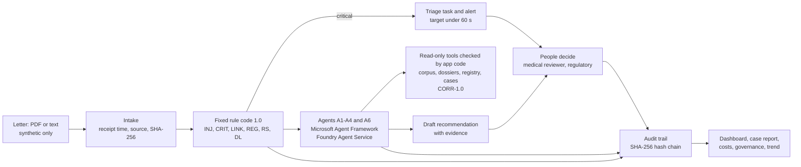

# PMS agent demo – multi-agent post-market surveillance for fictional class III implants

A demo of Case Study 5 (multi-agent post-market surveillance). Six agents on Microsoft Agent Framework
read synthetic physician letters about two fictional implant families – an aortic heart valve and a hip
system – match them with fictional product and registry data and draft a traceable recommendation.
Fixed rule code, not AI, detects critical cases, computes reporting deadlines for the EU (including
Ireland), Northern Ireland and Great Britain separately, and links duplicates and follow-ups. Every step
is written to a tamper-evident audit trail. Only the medical reviewer decides.

It runs offline with nothing but Python, or in one EU Azure region with the Azure Developer CLI (`azd`)
and Bicep.

> [!IMPORTANT]
> **Synthetic data only. The demo illustrates; it makes no compliance claim.**
>
> - All patients, persons, institutions, products, lots and UDIs are invented. Never enter real data.
> - The demo illustrates workflows. It makes no statement about conformity with MDR, UK MDR,
>   ISO 13485, GAMP 5 or any other requirement. The ISO and GAMP files used during the design are older
>   editions (DIN EN ISO 13485:2007-10, that is ISO 13485:2003, and a GAMP 5 overview from 2013).
> - It is not a medical device and gives no regulatory, legal or medical advice.
> - Agents only recommend; every AI output is labelled "draft". **Only the medical reviewer** – a person
>   – approves, rejects, closes a case or lowers its urgency, always with a reason.
> - **Nothing is ever sent to an authority.** Authorities appear only as labels. E-mails go only to the
>   demo recipients you configure.

## Contents

1. [Purpose](#purpose)
2. [Architecture](#architecture)
3. [Prerequisites](#prerequisites)
4. [Offline quick start (no installs)](#offline-quick-start-no-installs)
5. [Deploy to Azure](#deploy-to-azure)
6. [Smoke test](#smoke-test)
7. [Presenter demo script (10–15 minutes)](#presenter-demo-script-1015-minutes)
8. [Cost estimate (as of 10 Nov 2026)](#cost-estimate-as-of-10-nov-2026)
9. [Teardown](#teardown)
10. [Troubleshooting](#troubleshooting)
11. [Sign-in with Microsoft Entra ID only](#sign-in-with-microsoft-entra-id-only)
12. [Well-Architected alignment](#well-architected-alignment)
13. [Limits and deviations](#limits-and-deviations)
14. [Roadmap](#roadmap)
15. [Tests and CI](#tests-and-ci)
16. [Repository layout and documentation](#repository-layout-and-documentation)

## Purpose

Customer and partner engineers should be able to deploy and present this demo without help. It shows,
with synthetic letters in German, English, French and Italian:

- how agents read letters, match them with implant and product data and draft a traceable
  recommendation on whether a product defect is possible – with evidence from further (fictional)
  sources such as literature summaries, past cases and technical documents;
- how critical cases reach a person at once (triage task and alert within a 60-second target) while the
  analysis is still running;
- how reporting deadlines for the EU, Ireland, Northern Ireland and Great Britain are tracked;
- how every step is logged with time, source, agent (with model, prompt and rule versions) or user;
- how only the medical reviewer decides, and how an approval is bound to exactly the reviewed version.

In Case Study 5, the fictional manufacturer wants earlier medically accountable decisions and on-time
vigilance reports while its portfolio grows. Those are exercise targets, not results; the demo does not
measure or promise them.

## Architecture



**Agents** (one interface; Microsoft Agent Framework with Foundry Agent Service in Azure, a deterministic
offline stand-in locally):

| Agent | Task | Model in Azure | Autonomy and limits |
|---|---|---|---|
| A1 Signal ingestion | Reads the letter text; returns facts with verbatim quotes | gpt-6.1-sol | No decision; quotes checked against the text; empty means unknown; may only raise urgency |
| A2 Product and implant matching | Proposes the product match; explains registry differences | gpt-6.1-sol | Proposal only; a registry mismatch is always shown |
| A3 Medical analysis and causality | Draft causality (not related, possible, probable, causal), "product defect possible", evidence for and against, uncertainty, missing data, IMDRF code candidates | gpt-6-astra | Recommendation only (L2); may only raise urgency; never decides reportability |
| A4 Vigilance reporting | Draft report text per rule set; deadline overview from the rule code | gpt-6.1-sol | Drafts only; no submission, no sending |
| A5 Light trend view | Six synthetic monthly rows | no model | Counts only; no statistics; interpretation only by people |
| A6 Evidence and correlation | Searches the fictional corpus through a read-only tool and correlates hits with quote and source ID | gpt-6-astra | Recommendation only (L2); at most 2 rounds and 8 tool calls; "no hits" is never an all-clear |

**Fixed rule code** (runs before any agent; no agent can overwrite it; versions in every audit record):

| Rule | What it does |
|---|---|
| CRIT-1.0 | Critical detection: raw-text scan in DE, EN, FR and IT for death, serious public health threat and serious deterioration; also critical when the earliest deadline is due within 48 hours. In doubt critical; only a person lowers urgency. |
| DL-1.0 | Deadlines: day 1 is the day after the first receipt; 2, 10 or 15 calendar days; every rule set's deadline shown, the earliest drives priority; follow-ups never reset it; the clock stops only when a person records a submission. |
| RS-1.0 | Rule set and authority label per incident state; EU, Ireland, Northern Ireland and Great Britain separately; France shows "route unverified". |
| LINK-1.0 | Links duplicates and follow-ups; every signal stays visible. |
| REG-1.0 | Registry check: `MATCH`, `MISMATCH`, `NO_IDENTIFIERS` or `NOT_FOUND`, never silently dropped. |
| INJ-1.0 | Prompt-injection detection: visible flag and audit record; labels unchanged. |
| CORR-1.0 | Deterministic correlation over corpus, registry and all cases: named matches and counts only, no rates. |

**Workflow:** a fixed state machine (Received, Triage required, In analysis, Draft ready, In medical
review, Approved, Rejected, Submission recorded, Closed, ...). The system only sets technical statuses
and only raises urgency. A critical case waits for a person to take over the triage. Approve, reject,
request information, close and "non-reportable" belong to the medical reviewer, always with a reason;
an approval is void as soon as anything in the case changes. No timer ever decides.

**Audit trail:** exactly one record per status change, agent run, rule evaluation, human decision and
metadata edit – with UTC time, source, actor type, agent with model, prompt and rule versions or the
user, case, before and after values, and reason. Records are chained with SHA-256 and can only be
appended; `verify-audit` recomputes the chain.

**Web app** (server-rendered pages, a disclaimer banner on every page, every action checked by the role
matrix on the server):

| Page | Content |
|---|---|
| `/` Dashboard | Counts; **critical queue first**, sorted by the earliest deadline, with countdown and OVERDUE marks; other and closed cases with status and the progress of each agent (A1, A2, CORR-1.0, A6, A3, A4); A5 trend panel; *Upload a letter* (file or pasted text); *Load demo data* (operator) |
| `/cases/{id}` | Original letter (injected paragraphs marked), all signals incl. duplicates and follow-ups, facts with source quotes, registry check, draft recommendation with evidence and IMDRF candidates, correlation, report drafts, deadlines per rule set, decisions, metadata edits, tasks and alerts, agent runs, audit history – and the actions (triage, review, decision, metadata edit, urgency, re-analysis, recorded submission, add a signal) |
| `/rejected` | Rejections with reason code R1 to R6, reason and reviewer |
| `/unreadable` | Unreadable and unmatched inputs, each with an open task |
| `/trend` | The six synthetic monthly rows: counts only, "denominator unknown, no rates" |
| `/costs` | Model costs per agent run and per case, platform costs, forecast and budget (offline labelled "simulated") |
| `/governance` | Versions, evaluation status, open human decisions, deadlines, audit status, process findings |
| `/audit` | The audit trail with filters (case, event type) and the result of the chain check |
| `/login` | Offline only: the user picker for the local test users. In Azure: sign-in with Microsoft Entra ID |

The JSON API behind the pages is listed in [docs/architecture.md](docs/architecture.md#http-api).

**Azure resources** (one resource group in one EU region):

| Resource | Used for |
|---|---|
| Microsoft Foundry account and project (Foundry Agent Service) | Agents; model deployments gpt-6-astra and gpt-6.1-sol, Data Zone Standard EU |
| Azure AI Search (Basic) | Index of the fictional knowledge corpus |
| Azure Container Apps (web app and alert worker) and Container Registry (Basic) | The app, one image, two processes; the worker always runs one replica |
| Azure Cosmos DB for NoSQL (serverless) | Containers `cases`, `signals`, `records` (all other data, the analysis-job queue and the published agent versions) and `audit` (append-only data role) |
| Storage account | Blob containers `letters`, `reports` and `outbox` (a copy of every alert e-mail) |
| Azure Communication Services Email | Critical-case e-mails to demo recipients, sent in the background and retried by the worker |
| Application Insights, Log Analytics, workbook, alert rules | Tracing and monitoring |
| Budget, Azure Policy | Cost notifications; only the selected region allowed |
| Microsoft Entra app registration, managed identity | Sign-in with app roles; keyless access to all services |
| Key Vault | Empty by default (fallback only) |

Details: [docs/architecture.md](docs/architecture.md) and the decision records
[ADR-001 to ADR-011](docs/adr/).

## Prerequisites

| | Offline (local) | Azure deployment |
|---|---|---|
| Software | **Python 3.12 or newer** and bash, or PowerShell 7.2 or newer (`pwsh`). No Python packages to install. | Azure CLI 2.67 or newer, Azure Developer CLI 1.18 or newer, Python 3.12 or newer, bash or PowerShell 7.2 or newer (`pwsh`). No local Docker: images are built in Azure Container Registry. |
| Azure roles | – | **Owner**, or **Contributor plus User Access Administrator**, on the subscription. The template creates the resource group, role assignments, a custom role, a policy assignment and a budget. |
| Microsoft Entra rights | – | The right to create app registrations (tenant setting "Users can register applications", or a role such as Application Developer, Cloud Application Administrator or Application Administrator) – **or** an app registration prepared by an admin ([bring your own](#bring-your-own-app-registration)). |
| Region | – | One EU region. Default **Sweden Central** (`swedencentral`); fallback Germany West Central (`germanywestcentral`). |
| Model quota | – | `gpt-6-astra` (version 2026-09-03) and `gpt-6.1-sol` (version 2026-09-29) as **Data Zone Standard** in the region, 50 thousand tokens per minute each by default. Never Global Standard. |
| Other | – | 15 resource providers registered (the preflight names any missing one); an e-mail address for budget and operations alerts (`DEPLOYER_EMAIL`). |

The preflight script checks all of this before anything is created.

On Windows, the `.ps1` scripts need PowerShell 7 (`pwsh`); the *Windows PowerShell* 5.1 that comes with
Windows is not supported (see [step 1 of the quick start](#offline-quick-start-no-installs)).

## Offline quick start (no installs)

Runs on your machine with the Python standard library only: no Azure, no model calls, nothing to
install. The agents are a deterministic offline stand-in with fixed answers, labelled as such.

**1. Get the code.** Clone this repository or unzip the delivered `pms-agent-demo.zip`. Open a terminal
in the repository folder (the folder that contains this README).

On Windows:

- Run the PowerShell commands in **PowerShell 7**: type `pwsh` and press Enter (install it once with
  `winget install --id Microsoft.PowerShell --source winget`). The *Windows PowerShell* 5.1 that comes
  with Windows is not supported; the scripts stop at once with a `#requires` message for PowerShell 7.2.
  Step 2 also shows a direct start with Python that works there.
- If you unzipped a downloaded zip, Windows marks the files as coming from the internet, and PowerShell
  then asks before every script or blocks it. Unblock the files once, in the repository folder and only
  for a copy from a source you trust: `Get-ChildItem -Recurse -File | Unblock-File`. A `git clone` needs
  no unblocking.
- Prefer a folder that OneDrive does not sync, for example `C:\src`: the demo writes its SQLite
  database and the local alert outbox to `var/`.

**2. Start the demo.** It loads the 12 synthetic letters and the 6 seed messages on start, runs the
offline agents in the background and keeps running until you press Ctrl+C.

```bash
bash scripts/run-local.sh
```

PowerShell 7.2 or newer (in `pwsh`, see step 1):

```powershell
./scripts/run-local.ps1
```

Without bash and without PowerShell 7 – for example in the *Windows PowerShell* 5.1 that comes with
Windows – start the offline demo directly with Python. This is the command the scripts run; open a new
terminal for it, so that no Azure settings from an earlier session are set:

```powershell
$env:PYTHONPATH = "src"; python -m pms serve --seed
```

It is ready when it prints `listening on http://127.0.0.1:8000/`. The default port is 8000. If that port
is taken, the start picks the next free port, prints `Port 8000 is in use - using port 8001 instead.` and
listens there; use the printed URL below. To choose a port yourself, pass it – the scripts hand the option
to `python -m pms serve`:

```bash
bash scripts/run-local.sh --port 8765
```

PowerShell: `./scripts/run-local.ps1 --port 8765`. Then use that port in the URLs below.

**3. Open the printed URL** (normally <http://127.0.0.1:8000>) and pick a demo user on the sign-in page. There is one test user per
role: `viewer`, `analyst`, `regulatory`, `reviewer` (medical reviewer) and `operator`. The choice is kept
in a cookie in this browser; *Switch user* at the top changes it. Critical cases are at the top of the
dashboard with a countdown; alerts go to the local outbox (`var/outbox/`) instead of e-mail. Scripts and
API clients send the header `X-Demo-User` instead of the cookie (optional example, needs curl):
`curl -H "X-Demo-User: viewer" http://127.0.0.1:8000/api/cases`.

**4. Run the golden run** in a second terminal in the same folder. It runs the full offline pipeline
(rules, alerts, offline agents, case reports, audit trail) on a fresh database with all letters and seed
messages in order of receipt, compares every rule-based field with `data/synthetic/expected.json`, and
checks the alert timings, the completeness of the case reports and the audit chain. It exits with code 0
only when everything passes, including a 100 % match of the rule-based fields.

```bash
PYTHONPATH=src python3 -m pms golden --out var/golden-summary.json
```

PowerShell:

```powershell
$env:PYTHONPATH = "src"; python -m pms golden --out var/golden-summary.json
```

It prints the matched rule fields (`228/228`), the report and audit checks, the alert timing of each
critical letter – every critical letter needs its own triage task and alert, also a duplicate or
follow-up in a case that is already critical (`9/9`) – and `passed=True`; the full result is in
`var/golden-summary.json`.

**5. Optional checks** – all tests (about 300; a few minutes) and the audit chain of the running demo:

```bash
PYTHONPATH=src python3 -m unittest discover -s tests -t .
bash scripts/verify-audit.sh
```

PowerShell: `$env:PYTHONPATH = "src"; python -m unittest discover -s tests -t .` and
`./scripts/verify-audit.ps1`. `verify-audit` ends with `audit chain OK: <n> records`.

**6. Stop** with Ctrl+C. To start again with an empty database, delete the `var` folder.

Notes:

- Use `python` instead of `python3` if that is how Python 3.12 is called on your machine.
- To upload a letter yourself, use *Upload a letter* on the dashboard (as analyst) with a file from
  `data/synthetic/letters/` (`.txt` or `.pdf`, at most 5 MiB) or pasted text. Reading PDF files needs the
  optional package `pypdf`; without it a PDF upload is shown as unreadable (it is never dropped).
- The demo data are loaded once; *Load demo data* (operator) skips messages that are already loaded.

## Deploy to Azure

Everything goes into one new resource group `rg-<environment name>` in one EU region. No secret is stored
anywhere: the app uses a managed identity, people sign in with Microsoft Entra ID, and the pipeline uses
OpenID Connect. Call the scripts as shown (`bash scripts/<name>.sh` or `./scripts/<name>.ps1`). On Windows,
run the `.ps1` scripts in PowerShell 7 (`pwsh`) and unblock a downloaded zip first
([quick start, step 1](#offline-quick-start-no-installs)).

### Step 1 – Sign in and create an azd environment

The same commands work in bash and PowerShell.

```bash
az login
azd auth login
azd env new pms-demo --location swedencentral --subscription <subscription-id>
azd env set DEPLOYER_EMAIL you@example.com
```

- `DEPLOYER_EMAIL` receives the budget and operations alerts. If it is empty, the preflight tries to use
  the e-mail address of your signed-in account.
- Optional: `azd env set ALERT_RECIPIENTS demo1@example.com,demo2@example.com` sets the recipients of
  critical-case e-mails (demo mailboxes only; default: `DEPLOYER_EMAIL`).

### Step 2 – Choose the app roles for yourself

After provisioning, the postprovision hook assigns you the app roles in `DEPLOYER_APP_ROLES` (default
`PMS.Operator`, enough to load the demo data). To present the whole story or run the human check with
one account, add the other roles **before** you deploy:

```bash
azd env set DEPLOYER_APP_ROLES PMS.Operator,PMS.Analyst,PMS.MedicalReviewer,PMS.Regulatory
```

To show a real separation of duties, use several accounts and assign their roles in Entra (step 5).

### Step 3 – Preflight

```bash
bash scripts/preflight.sh
```

PowerShell: `./scripts/preflight.ps1`

The preflight checks tool versions; az and azd sign-in and the subscription; the region (EU allow-list
and available to you); 15 resource providers; your Azure roles; your right to create app registrations
(or your own registration); each model, version and Data Zone Standard offer in the region; free quota;
Foundry projects (Agent Service) in the region; the built-in role and policy definitions; the e-mail
addresses; the Cost Management API (warning only); that `infra/main.bicep` compiles; and names still
blocked by soft-deleted resources of an earlier deployment. A failed check stops with one line:
`FAILED: <problem> Fix: <command>`.

### Step 4 – Deploy

```bash
bash scripts/deploy.sh -e pms-demo
```

PowerShell: `./scripts/deploy.ps1 -EnvironmentName pms-demo`

`deploy` runs the preflight and then `azd up`. You can also run `azd up` directly; its preprovision hook
runs the same preflight. For the Gate C evidence, record the output:
`bash scripts/deploy.sh -e pms-demo 2>&1 | tee deploy.log` (PowerShell:
`./scripts/deploy.ps1 -EnvironmentName pms-demo *>&1 | Tee-Object -FilePath deploy.log`).

What happens:

1. **Preflight** (as in step 3).
2. **Provision** (Bicep): the resource group, all resources, the Entra app registration (unless you bring
   your own) and the two container apps, at first with a public placeholder image.
3. **Postprovision hook:** pre-authorises the Azure CLI for the app's API (so the scripts can get a
   token) and assigns your app roles from `DEPLOYER_APP_ROLES`.
4. **Deploy:** builds the image in Azure Container Registry and deploys the web app and the alert worker.
5. **Postdeploy hook:** waits until `/healthz` answers and prints the next steps. If the Azure Python
   packages are installed on your machine (`pip install -r requirements.txt`), it also builds the Azure AI
   Search knowledge index (`python -m pms seed --index-only`) and publishes changed Foundry prompt agents
   (`python -m pms publish-agents`) with your sign-in; without the packages, or without the data roles
   for it, it prints a note and continues. Both steps are idempotent, and the worker container runs them on
   every start with its managed identity anyway. `AUTO_SEED=true` also loads the demo data.

Provisioning takes a while; the model deployments and the first image build are the slowest parts.

### How the app runs in Azure

- **Two container apps from one image.** `ca-web-...` serves the pages and the API behind Microsoft
  Entra sign-in; `ca-worker-...` (exactly one replica, no ingress, `/healthz` for its probes) runs the
  analysis jobs, the alert retries, the deadline sweep (every 60 seconds) and the heartbeat. Both share
  one Cosmos DB store, so a separate worker needs `COSMOS_ENDPOINT`.
- **Cosmos DB:** `cases` and `signals` (partition key = case ID), `records` for every other table
  (tasks, alerts, deadlines, decisions, approvals, submissions, metadata edits, findings, costs, agent
  runs, recommendations, facts, correlations) plus the analysis-job queue, counters, a short write lease
  and the published Foundry agent versions, and `audit` – the hash chain, written with create only.
- **Blob Storage:** `letters` (originals), `reports` (exported case reports) and `outbox` (a copy of every
  alert e-mail).
- **Alert e-mail never blocks an upload.** The upload records the alert, the triage task and the audit
  record and returns at once; a background thread sends the e-mail through Communication Services and
  keeps a copy in the `outbox` container. The worker retries alerts that are still pending after
  10 seconds or failed (pauses of 5, 15, 45 and 135 seconds, at most 5 attempts); a delivery claim keeps
  two processes from sending the same alert.
- **Links in alert e-mails** point to the case in the web app: the templates set the app setting
  `PUBLIC_BASE_URL` to the web address (`WEB_URL`).
- **Knowledge index and agents.** The worker brings the Azure AI Search index (`pms-knowledge`) up to date
  with the fictional corpus and publishes changed Foundry prompt agents on every start, in the
  background. Both are idempotent: unchanged index documents and unchanged agent specifications are
  skipped. To run them from your machine, run the hook again: `bash scripts/postdeploy.sh` (PowerShell:
  `./scripts/postdeploy.ps1`). It takes the values from the azd environment and calls
  `python -m pms seed --index-only` and `python -m pms publish-agents` when the Azure packages are
  installed; `seed --index-only --force` uploads every index document again.

### Step 5 – Roles, demo data, first sign-in

1. Give demo users their app roles: Microsoft Entra admin center > Enterprise applications >
   *PMS agent demo (&lt;environment name&gt;)* > Users and groups > Add user/group. Roles:
   `PMS.Viewer`, `PMS.Analyst`, `PMS.Regulatory`, `PMS.MedicalReviewer`, `PMS.Operator`. Users without a
   role cannot sign in.
2. Sign in again so that new tokens contain the roles: run `az login`, and in the browser sign out and
   back in.
3. Load the demo data (needs `PMS.Operator`):

   ```bash
   bash scripts/seed.sh --azure
   ```

   PowerShell: `./scripts/seed.ps1 -Azure`. For the [presenter script](#presenter-demo-script-1015-minutes),
   upload the first letter before you load the demo data.
4. Open the app: `azd env get-value WEB_URL`.

### Bring your own app registration

If you may not create app registrations, the preflight says so. Ask an Entra admin to create one:

1. App registration, single tenant (accounts in this organizational directory only).
2. App roles with the values `PMS.Viewer`, `PMS.Analyst`, `PMS.Regulatory`, `PMS.MedicalReviewer` and
   `PMS.Operator` (allowed member type: users).
3. Expose an API: Application ID URI (default `api://<client-id>`) with the scope `user_impersonation`;
   add Azure CLI (`04b07795-8ddb-461a-bbee-02f9e1bf7b46`) as an authorized client application for it.
4. Authentication: ID tokens enabled; access token version 2 (manifest `requestedAccessTokenVersion: 2`).
5. Recommended: Enterprise applications > the app > Properties > *Assignment required* = Yes.

Then, before you deploy:

```bash
azd env set ENTRA_EXISTING_APP_CLIENT_ID <client-id>
```

Only if the Application ID URI is not `api://<client-id>`:
`azd env set ENTRA_EXISTING_APP_IDENTIFIER_URI <uri>`.

After provisioning, the postprovision hook prints the redirect URI (`azd env get-value WEB_REDIRECT_URI`,
of the form `https://<web-app>/.auth/login/aad/callback`). The admin adds it as a Web redirect URI of the
registration. Teardown never deletes a registration you brought yourself.

### Model quota and fallback

- The preflight compares the free quota (limit minus usage, plus your own existing deployment) with the
  requested capacity of each model.
- Too little quota: request more in the Foundry portal (Operate > Quota), or lower the capacity, for
  example `azd env set MODEL_ANALYSIS_CAPACITY 20` and `azd env set MODEL_GENERAL_CAPACITY 20`
  (thousand tokens per minute; billing is per token, not per capacity).
- gpt-6-astra not offered as Data Zone Standard in your region (availability can change, OI-010): use
  the documented fallback `azd env set MODEL_FALLBACK_ALL_GENERAL true` (gpt-6.1-sol for all agents),
  or another EU region. Global Standard is never allowed.

### Deploy from GitHub Actions (OIDC)

`.github/workflows/deploy.yml` deploys on demand. It signs in with OpenID Connect; no secret is stored
in GitHub. One-time setup:

1. In GitHub: Settings > Environments > create the environment `azure-demo` (add required reviewers if
   you like).
2. In Azure: an identity for the pipeline with a federated credential for that environment, and Owner
   (or Contributor plus User Access Administrator) on the subscription:

   ```bash
   az ad app create --display-name pms-agent-demo-deploy
   az ad sp create --id <app-id>
   az ad app federated-credential create --id <app-id> --parameters '{"name":"github-azure-demo","issuer":"https://token.actions.githubusercontent.com","subject":"repo:<owner>/<repository>:environment:azure-demo","audiences":["api://AzureADTokenExchange"]}'
   az role assignment create --assignee <app-id> --role Owner --scope /subscriptions/<subscription-id>
   ```

   A user-assigned managed identity with a federated credential works as well.
3. A service principal usually cannot create app registrations: prepare one as in
   [bring your own](#bring-your-own-app-registration).
4. Repository variables (Settings > Secrets and variables > Actions > Variables – variables, not
   secrets): `AZURE_CLIENT_ID` (the pipeline identity), `AZURE_TENANT_ID`, `AZURE_SUBSCRIPTION_ID`,
   `AZURE_ENV_NAME`, `AZURE_LOCATION`, `DEPLOYER_EMAIL`, `ALERT_RECIPIENTS`,
   `ENTRA_EXISTING_APP_CLIENT_ID`; optional `MODEL_FALLBACK_ALL_GENERAL`.
5. Actions > *Deploy to Azure (manual)* > Run workflow, and type `DEPLOY`.

After a pipeline run, assign app roles to people in Entra. To use the local scripts (seed, smoke test)
against that deployment, create the same azd environment locally and pull its values:
`azd env new <AZURE_ENV_NAME> --location <region> --subscription <subscription-id>`, then
`azd env refresh`.

### Configuration (azd environment)

Set with `azd env set <NAME> <value>`, then run `azd provision` (or `azd up`) again.

| Name | Default | Effect |
|---|---|---|
| `DEPLOYER_EMAIL` | your account's e-mail | Budget and operations alerts (required) |
| `ALERT_RECIPIENTS` | `DEPLOYER_EMAIL` | Critical-case e-mails; demo mailboxes only |
| `DEPLOYER_APP_ROLES` | `PMS.Operator` | App roles assigned to you after provisioning |
| `ENTRA_EXISTING_APP_CLIENT_ID` | empty | Bring your own app registration |
| `ENTRA_EXISTING_APP_IDENTIFIER_URI` | `api://<client-id>` | Application ID URI of your own registration |
| `MODEL_FALLBACK_ALL_GENERAL` | `false` | `true` = gpt-6.1-sol for all agents |
| `MODEL_DEPLOYMENT_SKU` | `DataZoneStandard` | `Standard` = processing in the region only; Global Standard is refused |
| `MODEL_ANALYSIS_CAPACITY`, `MODEL_GENERAL_CAPACITY` | `50` | Thousand tokens per minute; must fit your quota |
| `CUSTOM_CONTENT_FILTER` | `true` | Content filter with Prompt Shields; `false` = built-in default policy |
| `AZURE_SEARCH_SKU` | `basic` | `free`, `basic` or `standard` |
| `BUDGET_USD` | `250` | Monthly budget of the resource group (notifications only) |
| `BUDGET_START_DATE` | first day of the current month | `yyyy-MM-01` |
| `WEB_MIN_REPLICAS` | `0` | `1` avoids cold starts during presentations (extra cost) |
| `WORKER_HEALTH_PROBES` | `true` | Health probes of the alert worker |
| `PREVIEW_MONITORING` | `false` | Preview monitoring features; leave off unless the project owner approves (OI-032) |
| `AZURE_STORAGE_SKU` | `Standard_LRS` | `Standard_ZRS` = zone-redundant storage |
| `LOG_RETENTION_DAYS`, `LOG_DAILY_CAP_GB` | `30`, `1` | Log retention and daily ingestion cap |
| `AUTO_SEED` | off | `true` = the postdeploy hook loads the demo data |
| `PREFLIGHT_SKIP` | empty | Comma-separated preflight checks to skip, only for a known false alarm |

These are inputs of the templates. The environment variables of the running app (endpoints, model
deployments, `PUBLIC_BASE_URL` and others) are listed in
[docs/architecture.md](docs/architecture.md#configuration).

## Smoke test

The live smoke test checks the deployment in two parts (Gate C). It uses your Microsoft Entra sign-in:
the scripts get a token through the Azure CLI and never print it. Run it after
[step 5](#step-5--roles-demo-data-first-sign-in); your account needs at least `PMS.Analyst` (upload).

**Part 1 – automated:**

```bash
bash scripts/smoke-test.sh --part 1
```

PowerShell: `./scripts/smoke-test.ps1 -Part 1`.

Part 1 checks `/healthz`, that the API refuses requests without sign-in and answers with your token. It
then uploads a synthetic critical smoke-test letter, which creates a new fictional case, and checks the
alert within 60 seconds, that the case waits for human triage, that the analysis finishes (it waits up to
10 minutes) with a complete case report and a draft recommendation, that a decision is refused for a
token without the medical-reviewer role, the audit chain and the cost view. If your token has the role
`PMS.MedicalReviewer`, the decision-refused check is skipped. Each check prints `PASS`, `FAIL` or `SKIP`;
the result and the ID of the smoke case (`smoke_case_id`) are written to `smoke-test-result.json`.

**Keep the part-1 result.** Part 2 reads the smoke case ID from `smoke-test-result.json` and then replaces
the file with its own result, so copy it first:

```bash
cp smoke-test-result.json smoke-test-result-part1.json
```

PowerShell: `Copy-Item smoke-test-result.json smoke-test-result-part1.json`

**Human check – in the browser, as medical reviewer:**

1. Open the smoke case (the ID in `smoke_case_id`; fictional patient `P-ZZ-...`). Take over the triage;
   when the case shows *Draft ready*, take over the review and **approve** it with a reason. Do not edit
   the smoke case afterwards – any change voids the approval.
2. **Reject** another case with a reason code (R1 to R6) and a reason.
3. **Edit one metadata field** of a third case with a reason.
4. Take a screenshot.

**Part 2 – checks the human decision and the audit trail:**

```bash
bash scripts/smoke-test.sh --part 2
```

PowerShell: `./scripts/smoke-test.ps1 -Part 2`. Part 2 checks that the smoke case carries a human
decision with a reason, that the approval is bound to a content hash, that no agent or system decided,
that the case report shows the reviewer decision and that the audit chain still verifies. It writes its
result to `smoke-test-result.json`.

Hand over `deploy.log`, `smoke-test-result-part1.json`, `smoke-test-result.json`, `notes.md` and the
screenshot as described in [docs/handover-checklist.md](docs/handover-checklist.md).

## Presenter demo script (10–15 minutes)

**Before the audience**

- Azure (real models, recommended): deployment healthy; your account (or several accounts) has the roles
  analyst, medical reviewer, regulatory and operator; the alert mailbox is open; the file
  `data/synthetic/letters/L03_en_cardio_pht_ie.txt` is at hand. Do **not** load the demo data yet, so
  that the uploaded letter becomes the first case. Optional: `azd env set WEB_MIN_REPLICAS 1` and
  `azd provision` to avoid a cold start (extra cost).
- Offline rehearsal of the same flow: start an empty instance without demo data (add `--port 8765` if
  port 8000 is taken).

  ```bash
  DATA_DIR=./var/presenter PYTHONPATH=src python3 -m pms serve
  ```

  PowerShell: `$env:DATA_DIR = "./var/presenter"; $env:PYTHONPATH = "src"; python -m pms serve`.
  Offline you switch roles with *Switch user* at the top of the page.

**The story**

| Time | Step | What to show and say |
|---|---|---|
| 0:00 | Frame | The disclaimer banner: synthetic data, illustration, no compliance claim. Agents recommend; people decide; nothing goes to an authority. |
| 1:00 | Upload a critical letter (analyst) | Dashboard > *Upload a letter*: choose `L03_en_cardio_pht_ie.txt` – three patients with valves from the same lot, torn leaflets six to ten weeks after implantation, Ireland. The fixed rule code runs before any agent. |
| 2:00 | Triage task and alert within 60 seconds | The new case is on top of the *Critical queue* with status *Triage required* and a countdown. Deadlines: 2 calendar days (serious public health threat) next to 10 days (serious deterioration); the earliest drives priority; rule set `EU-MDR:IE`, authority label "IE HPRA (published route)" – a label, nothing is sent. Show the alert e-mail (Azure) or the outbox entry (offline, `var/presenter/outbox/`): case ID, critical reason and link only. |
| 3:30 | Agent progress | On the case page: *Take over the triage* (analyst). Show the progress of each agent (A1, A2, CORR-1.0, A6, A3, A4); facts with verbatim quotes (A1); registry check `MATCH` for the three patients (REG-1.0, A2); correlation (CORR-1.0, A6). The analysis never delays the triage. |
| 5:00 | Draft recommendation with evidence | Labelled "Draft (Entwurf)". Causality on the 4-level scale (ranges not clinically validated), "product defect possible", evidence for and against with source IDs and quotes – for example an earlier case with the same lot, a lot-release deviation, two more registry patients with this lot, a case series. Uncertainty and missing data stay visible; IMDRF code candidates come from a two-code demo list. A4's report draft is not sent. |
| 7:30 | The medical reviewer decides | As medical reviewer: *Take over the review*, then *Record decision* with "Approve this version" and a reason – the approval binds to exactly this version. Or reject with a reason code (R1 to R6) and a reason, and open *Rejected*. Point out that an analyst cannot approve (the action is marked as not permitted, and the server refuses and records any attempt) and that agents have no decision rights. |
| 9:00 | Metadata edit | *Edit metadata*: change a field with a reason (*Save change*). The case page lists user, old and new value. If the case was approved, the approval is now void and the case is back in review. |
| 10:00 | Audit chain | Open *Audit trail*: every step with time, actor and versions, and the result of the chain check (in Azure also `bash scripts/verify-audit.sh --azure`). Changing any stored record would break the chain. |
| 11:00 | Costs and governance | *Costs*: tokens and model costs per agent run and per case, platform costs and forecast with their data date (Azure) or labelled "simulated" (offline), budget. *Governance*: app, model, prompt, rule and corpus versions, evaluation status, open human decisions, deadlines, audit status, process findings. |
| 12:30 | Trend view | *Trend*: six synthetic monthly rows with unit and period, "denominator unknown, no rates"; interpretation only by people. |
| 13:30 | Close | Roadmap: PSUR authoring is roadmap only and not part of the demo; statistical signal detection, OCR and licensed literature sources are roadmap items. Name the limits. |

**Optional, about 3 more minutes – the full data set.** As operator, press *Load demo data* on the
dashboard (Azure: or `bash scripts/seed.sh --azure`). The demo data contain L03 again; it is linked to
your uploaded case as a duplicate and, like every critical letter, gets its own triage task and alert
("new signal on critical case …"). Then show:

- L07, an unrelated appendicitis, stays critical until a medical reviewer lowers the urgency with a
  reason – offline the stand-in even answers "not serious", and the urgency stays;
- L08, place GB or NI unclear: two rule sets and two deadlines;
- L10, a follow-up that makes L09's case critical while the deadline stays anchored to the first letter;
- L11: a registry mismatch; *Unreadable & unmatched* lists inputs that could not be matched;
- L12, a copy of L02 with an injected instruction: same labels, a visible flag, linked as a duplicate;
  its alert says that the embedded instructions were ignored and withheld from the agents;
- the seed cases appear overdue because their receipt dates are in September 2026.

## Cost estimate (as of 10 Nov 2026)

Indicative list prices in USD from the public Azure pricing pages, read on **10 Nov 2026**. The Azure
Retail Prices API was not reachable from the build workspace (OI-017). The EU data zone price factor for
the GPT-6 model family is **not confirmed** (OI-031). Taxes and currency conversion are not included.
Check current prices before you deploy.

| Item | Assumption | USD per month |
|---|---|---|
| Container Apps | 1 replica always on (alert worker), 0.5 vCPU and 1 GiB, mostly idle; the web app scales to zero | about 10–12 |
| Azure AI Search | Basic, 1 search unit (73.73 USD per month) | about 74 |
| Azure Container Registry | Basic, 0.167 USD per day | about 5 |
| Log Analytics and Application Insights | Traces and metrics of a demo, 30 days retention; depends on data volume | estimated 5–15 |
| Cosmos DB, Storage, Key Vault, Communication Services | Small volumes | under 3 |
| **Base load** | Without model use, mostly idle | **about 95–110** |
| Models per golden run (decision Q-10) | gpt-6-astra Data Zone 11 USD input and 55 USD output per 1 million tokens for A3 and A6; gpt-6.1-sol Data Zone 2.20 and 11 USD for A1, A2 and A4; about 0.6–2 USD per case | **about 10–35 per run** |
| Models per golden run (gpt-6.1-sol only) | gpt-6.1-sol for all agents (`MODEL_FALLBACK_ALL_GENERAL=true`) | **about 3–8 per run** |
| **Budget (default)** | Includes some golden runs and presentations | **250**, with alerts |

- The budget sends e-mails to `DEPLOYER_EMAIL` at 50, 80 and 100 % of actual costs and at 100 % of the
  forecast. It does **not** stop spending.
- Not in the table: the four log alert rules (a small monthly charge each) and web-app replicas while
  the app is in use or when `WEB_MIN_REPLICAS=1`.
- In operation the app shows measured costs: tokens and model costs per agent run and per case (dated
  price table `config/pricing.json`), platform costs and a forecast from Cost Management.
- Lower costs: run `bash scripts/teardown.sh` after the demo; use `MODEL_FALLBACK_ALL_GENERAL=true`;
  `AZURE_SEARCH_SKU=free` is possible (one free service per subscription; not verified with the keyless
  access this demo uses, OI-035).

## Teardown

Removes everything the deployment created. Costs stop when the resources are deleted.

```bash
bash scripts/teardown.sh
```

PowerShell: `./scripts/teardown.ps1`. You confirm by typing the environment name; without a terminal use
`bash scripts/teardown.sh --confirm <environment name>` or
`./scripts/teardown.ps1 -ConfirmEnvironment <environment name>`.

The script:

1. runs `azd down --purge --force`: deletes the resource group with all resources and data and purges
   soft-deleted resources where Azure allows it;
2. deletes the custom role *PMS demo ACS e-mail sender* at subscription level;
3. deletes the Entra app registration that the deployment created (also from the Entra recycle bin where
   allowed). It never deletes a registration you brought yourself.

**Key Vault purge protection:** the Key Vault cannot be purged. It stays soft-deleted for 7 days and its
name stays reserved; a warning about a refused purge step is expected. To deploy again within these
7 days, use a new environment name (`azd env new <new name> ...`).

**Cosmos DB continuous backup:** a deleted Cosmos DB account stays restorable from its continuous backup
within the 7-day window (synthetic data only; the 7-day tier has no charge for backup storage).

The local azd environment values stay in `.azure/<environment name>/` (ignored by git); delete that
folder if you no longer need it.

## Troubleshooting

**Offline**

| Message or symptom | What to do |
|---|---|
| `Python 3.12 or newer was not found.` | Install Python 3.12 or newer and open a new terminal. |
| A `#requires` message for PowerShell 7.2, `PowerShell ... is too old.`, a security warning before each script, or a script blocked by the execution policy | Start PowerShell 7 with `pwsh` (install: `winget install --id Microsoft.PowerShell --source winget`) and run the script there, or start the demo without the script: `$env:PYTHONPATH = "src"; python -m pms serve --seed`. For a downloaded zip, run `Get-ChildItem -Recurse -File \| Unblock-File` once in the repository folder (only for a copy from a source you trust), or use `git clone`. |
| The start prints `Port 8000 is in use - using port … instead.`, or stops with "Address already in use" when you passed `--port` | Use the printed URL, or pass a free port: `bash scripts/run-local.sh --port 8765` (PowerShell: `./scripts/run-local.ps1 --port 8765`). |
| Every page shows *Sign in* / the API answers `401` "not signed in: pick a demo user" | Pick a user on the sign-in page (the browser must accept cookies), or send the header `X-Demo-User: <user>`. |
| `403` "Refused: ... (your roles: ...)" | The fixed role matrix does not allow this action for the user; the attempt is recorded (`ACCESS_DENIED`). Switch to the right user. |
| `403` "... refused (CSRF protection)" or `415` from a script | State changes need `POST` with JSON (`Content-Type: application/json`) or a form posted from the app's own pages. |
| A PDF upload shows as unreadable | Offline the optional package `pypdf` is missing (or the PDF has no text layer). Upload the `.txt` letter instead; the unreadable input stays visible under *Unreadable & unmatched*. |

**Azure**

Every failed preflight check prints one line `FAILED: <problem> Fix: <command>`. The most common ones:

| Message or symptom | What to do |
|---|---|
| `The Azure CLI is not signed in.` / `The Azure Developer CLI is not signed in.` | `az login` / `azd auth login` |
| `The Azure CLI uses subscription ... but the azd environment targets ...` | `az account set --subscription <id>` |
| `AZURE_LOCATION is not set.` / `Region ... is not an allowed EU region` / `not available to subscription` | `azd env set AZURE_LOCATION swedencentral` (fallback `germanywestcentral`). |
| `Resource provider ... is not registered` | `az provider register --namespace <namespace> --wait` |
| `Your identity needs Owner (or Contributor plus User Access Administrator) ...` | Ask a subscription owner for the role, then run the preflight again. |
| `You may not create Entra app registrations in this tenant.` / `A service principal usually cannot create Entra app registrations.` | [Bring your own app registration](#bring-your-own-app-registration). |
| `Model ... is not offered as DataZoneStandard in ...` | `azd env set MODEL_FALLBACK_ALL_GENERAL true`, or another EU region. Never Global Standard. |
| `Only ... of DataZoneStandard quota is free ...` / `No DataZoneStandard quota ...` | Lower `MODEL_ANALYSIS_CAPACITY` / `MODEL_GENERAL_CAPACITY`, or request quota in the Foundry portal (Operate > Quota). |
| `Foundry projects (Agent Service) are not offered in ...` | `azd env set AZURE_LOCATION swedencentral` |
| `DEPLOYER_EMAIL is not set` | `azd env set DEPLOYER_EMAIL you@example.com` |
| Warning: `The Cost Management API did not answer ...` | Some subscription offer types or missing rights do not allow the Cost Management APIs. The deployment continues; the cost view then shows token-based model costs only, with a notice (OI-030). |
| `infra/main.bicep does not compile` | `az bicep upgrade`. If the Microsoft Graph extension version in `infra/bicepconfig.json` is unknown, set the current version there (see [docs/handover-checklist.md](docs/handover-checklist.md#if-the-bicep-build-fails)). |
| `Key Vault ... is soft-deleted with purge protection ...` | The name is reserved for up to 7 days: use a new environment name (`azd env new <name>`), or recover the vault (`az keyvault recover --name <vault>`). |
| `Foundry account ... is soft-deleted.` | Run the purge command the message shows (`az cognitiveservices account purge ...`). |
| Sign-in says the user is not assigned to a role for the application | Assign an app role in Entra ([step 5](#step-5--roles-demo-data-first-sign-in)), then sign in again. |
| `Could not get a Microsoft Entra token ...` (seed, smoke test) | `az login --scope <the scope in the message>`; make sure you have a PMS app role. With your own registration, Azure CLI must be an authorized client application. |
| The web app takes long to answer the first request | Cold start: the web app scales to zero when idle. For presentations: `azd env set WEB_MIN_REPLICAS 1`, then `azd provision` (extra cost). The 60-second alert target is measured from the receipt of the letter: the alert is sent right after the rule code, and the always-on worker retries a failed delivery. |
| No alert e-mail within 60 seconds | The dashboard alert and the triage task do not depend on e-mail. Check that the worker app (`ca-worker-...`) runs, look in the junk folder (Azure-managed sender domain), check `ALERT_RECIPIENTS`, and look at the workbook *PMS agent demo – operations* (time to alert, worker heartbeat). |
| Health probes fail right after the first provision | Expected: a placeholder image runs until `azd deploy` has finished. |
| Budget creation fails because of its start date | Azure accepts a past start date only within the current month; set `azd env set BUDGET_START_DATE <yyyy-MM-01>` for the current month and provision again. |
| Postdeploy: "Index not updated from here" or "Agents not published from here" | Expected without the Azure packages or data roles on your machine: the worker container builds the index and publishes the agents on its start; check its log (`az containerapp logs show --name <worker app> --resource-group <rg>`). |
| The alert e-mail contains only a relative link `/cases/<id>` | The app setting `PUBLIC_BASE_URL` is empty, for example after a manual change of the container settings. Run `azd provision` again; it sets the web address. |
| `APP_ENV=azure with WORKER_MODE=separate needs COSMOS_ENDPOINT and COSMOS_DATABASE` | The worker shares the Cosmos DB store with the web app; provision again so that both settings are present. |
| `Refusing to start: APP_ENV=azure with LOCAL_TEST_USERS=true` | By design: test users exist only offline. Remove `LOCAL_TEST_USERS=true` from the container settings. |

More checks: `azd env get-values` shows all values; `az containerapp logs show --name <app> --resource-group <rg>`
shows the logs of the web app or the worker.

## Sign-in with Microsoft Entra ID only

- In Azure, people sign in **only** with Microsoft Entra ID: Container Apps built-in authentication,
  single tenant, sign-in enforced for every page and API; only `/healthz` is open.
- Rights come **only** from the app roles in the token: `PMS.Viewer`, `PMS.Analyst`, `PMS.Regulatory`,
  `PMS.MedicalReviewer`, `PMS.Operator`. The enterprise application requires an assignment, so users
  without a role cannot sign in.
- No client secret (ID-token flow). Multi-factor authentication comes from your tenant's Conditional
  Access policies.
- No local accounts in Azure: the app refuses to start when `APP_ENV=azure` and `LOCAL_TEST_USERS=true`,
  and it ignores the demo-user header and cookie there. Local test users exist only in the offline mode.
- The app reads the signed-in user and the app roles from the principal that the built-in
  authentication passes on; a request without it gets `401`. *Sign out* at the top of every page ends the
  session. `GET /api/me` shows the user and the roles that the app sees.
- The app reaches Azure services only with its managed identity; local (key) authentication is switched
  off where the service allows it.

## Well-Architected alignment

The demo follows the Azure Well-Architected Framework as far as it fits a self-deployed demo with
synthetic data ([ADR-011](docs/adr/ADR-011.md)). This illustrates the alignment; it is not a statement
of conformity.

| Pillar | In the demo |
|---|---|
| Reliability | Alert worker always on with health probes; retries with backoff for model and search calls; idempotent processing per signal; restart without lost deadlines; Cosmos DB continuous backup (7-day tier, point-in-time restore into a new account; no charge for its backup storage, a restore is charged); infrastructure as code |
| Security | Entra-only sign-in with app roles; managed identities instead of keys; local authentication off where possible; Key Vault with RBAC, soft delete and purge protection; HTTPS only; least privilege; Prompt Shields; secret scan; OIDC deployment without stored secrets |
| Cost optimization | Serverless and Basic tiers; budget with alerts; costs per case; forecast; cost tags; teardown script |
| Operational excellence | Bicep and azd; CI with lint, tests, Bicep build and a PSRule for Azure check; preflight and smoke test; diagnostics to Log Analytics; workbook and alert rules; versions in every audit record |
| Performance efficiency | Container Apps scale with load; limits on tool calls, rounds and run time; the alert latency is measured |

PSRule for Azure checks `infra/` in CI with pinned versions; every suppressed rule has a written reason
in `.ps-rule/waf-deviations.Rule.yaml`. After deploying you can also use the Well-Architected Review and
Azure Advisor; they are not part of the automated checks. The deviations are listed in the next section.

## Limits and deviations

**Deviations from the Well-Architected recommendations** (design concept section 6.11; options with
extra cost need the project owner's approval, OI-037):

- No zone redundancy and no second region. Option: zone-redundant environment and Cosmos DB;
  `AZURE_STORAGE_SKU=Standard_ZRS` is the one low-cost option offered as a parameter.
- No private networking: public endpoints protected by Entra ID and managed identities. Option: VNet
  integration with private endpoints.
- No Microsoft Defender for Cloud plans.
- Azure AI Search with one replica (no SLA); Azure Container Registry Basic (approved, Q-6); web app
  scales to zero; a single alert worker; no staging environment; no load tests.
- Application Insights still accepts ingestion with its connection string (needed by the Foundry
  tracing connection); Communication Services access keys cannot be switched off with the API version
  used (the app uses Entra ID only).

**Other limits:**

- **Preview monitoring is off** (agent monitoring dashboard, continuous evaluation, red teaming,
  insights); `PREVIEW_MONITORING=false` until the project owner decides (OI-032).
- **Offline stand-in versus real model:** offline answers are fixed and labelled "offline stand-in";
  they show the workflow, not model quality. Real model answers vary; Gate C checks them against the
  golden-set ranges.
- **Causality ranges are not clinically validated.** The 4-level scale of MDCG 2020-10/1 Rev. 1 is
  written for clinical investigations and is used here by analogy. No model is clinically validated.
- **Golden run:** compares rule-based fields only; the causality range is an AI field and is checked
  against the live model.
- **IMDRF:** only two codes are included – A0401 (Annex A, "Break") and F1905 (Annex F, "Device Revision
  or Replacement") – from the IMDRF Adverse Event Terminology, release 2026, annexes dated 2026-03-23
  (<https://www.imdrf.org/node/460>). Attribution: International Medical Device Regulators Forum
  (IMDRF). The IMDRF terms of use restrict use to non-commercial research or teaching unless authorised
  (OI-009). Codes are shown only as candidates pending human review; a shared code proves no causality.
- **Rules:** deadlines are calendar days without weekend or holiday extension (K-05); the GB start date
  of UK MDR Part 4A is taken as 16 June 2025 (K-08); the Northern Ireland rules rest on secondary sources
  (OI-007); the French ANSM route is unverified (OI-008). Sources: [docs/rule-sources.md](docs/rule-sources.md).
- **Critical detection is broad on purpose:** 9 of 12 golden letters end in a critical case state,
  including the unrelated letter L07, until a person lowers the urgency (OI-014).
- **Audit trail:** tamper-evident, not tamper-proof. An owner of the subscription (or of the local
  database file) can still delete resources or the whole store.
- **Seeds appear overdue:** the six seed messages keep their September 2026 receipt times (OI-018).
- **Knowledge corpus:** all literature, past cases and technical documents are invented and labelled
  fictional; the search has no internet access. A correlation is no proof of causality, and "no hits"
  is no all-clear.
- **Data residency:** one EU region; models as Data Zone Standard EU; Communication Services is a global
  service with data location Europe (OI-012). Traces contain prompt content (synthetic data only) and are
  kept 30 days (OI-033).
- **Costs** are indicative and dated; the Cost Management APIs are not available for every subscription
  offer type (OI-030).
- **Screenshots** of the UI are produced by the Playwright suite in CI (artifact `ui-screenshots`); this
  README contains none.
- **License:** MIT (see [LICENSE](LICENSE)), approved by the project owner on 11 Nov 2026. The two IMDRF terminology codes
  (A0401, F1905) are third-party content under the IMDRF terms of use and are not covered by the MIT license (OI-009).

## Roadmap

Out of scope for this demo (design concept section 3.3):

| Topic | Status |
|---|---|
| PSUR authoring (Case Study 5: L3 draft, reviewer approves) | Roadmap only; excluded by the Goal Card |
| Statistical trend and signal detection | Roadmap only; the demo shows counts |
| Real literature and knowledge sources (licensed databases, internet search) | Roadmap only, after a license and data-protection review; the demo uses a fictional corpus |
| Data request and response workflow, simulated submission | Out of scope; only drafts and a human-recorded status |
| Preview monitoring (agent monitoring dashboard, continuous evaluation, red teaming, insights) | Optional and off; enabled only after the project owner's decision |
| OCR for scanned letters (Azure Document Intelligence) | Roadmap only; an additional paid service |
| Interfaces to authorities (EUDAMED, MORE, HPRA) | Excluded; the demo never sends anything to an authority |
| Well-Architected production baseline (zone redundancy, private networking, Defender plans, second region) | Option only after approval; extra cost |
| Real patient, product or institution data; mass ingestion, social media, model training; automatic decisions on reportability, approval, closing or downgrading | Excluded |

## Tests and CI

Local (standard library only):

```bash
PYTHONPATH=src python3 -m unittest discover -s tests -t .
PYTHONPATH=src python3 -m pms golden --out var/golden-summary.json
python3 scripts/secret_scan.py
python3 scripts/validate_workflows.py --no-pyyaml
```

About 300 tests (unit, golden, authorization, UI and safety); the Azure adapters are tested against fake
SDKs, so nothing needs Azure. The browser tests in `tests/ui/playwright/` are skipped when Playwright is
not installed.

GitHub Actions (`.github/workflows/ci.yml`; no Azure sign-in, no secrets):

| Job | What it does | Artifact |
|---|---|---|
| Lint | ruff, `bash -n` and ShellCheck, PowerShell parser check | – |
| Tests | Unit, golden, authorization, safety and UI DOM tests; golden run with 100 % required | `golden-summary` |
| UI (Playwright) | Starts the offline demo and runs the browser tests with screenshots | `ui-screenshots` |
| Bicep | `az bicep build` of `infra/main.bicep` | `arm-templates` |
| Well-Architected check | PSRule for Azure with written suppressions (`.ps-rule/`, loaded with `-Path`) | `psrule-report` |
| Hygiene | Secret scan and workflow validation | – |

If a job fails, open the run: the summary page shows the annotations (GitHub shows only the first ten
per step) and, for the Well-Architected check, a table with every finding. The full logs of a run: open a
job, then the gear icon at the top right of the log, *Download log archive*.

`.github/workflows/deploy.yml` deploys only when started by hand ([OIDC setup](#deploy-from-github-actions-oidc)).

## Repository layout and documentation

```
README.md            this file
azure.yaml           azd project: web app and alert worker from one Dockerfile, hooks
infra/               Bicep (main.bicep, modules/, models.json, roles.json), PSRule test entry
src/pms/             Python package: rules/, agents/, web/, azure/ (Cosmos DB, Blob Storage and AI Search
                     adapters), pipeline, workflow, audit, store, CLI (python -m pms)
config/              dated price table (pricing.json)
data/synthetic/      frozen golden set v1.0: letters, dossiers, registry, seeds, knowledge corpus,
                     monthly counts, expected.json
scripts/             preflight, run-local, seed, deploy, smoke-test, verify-audit, teardown (bash and
                     PowerShell), postprovision and postdeploy hooks, secret_scan.py, validate_workflows.py
tests/               unit, golden, authorization, UI and safety tests
docs/                architecture, decision records, rule sources, handover checklist
```

| Document | Content |
|---|---|
| [docs/architecture.md](docs/architecture.md) | Components, path of a letter, statuses, roles, audit fields, offline and Azure mode, telemetry, cost monitoring, Well-Architected table |
| [docs/adr/](docs/adr/) | ADR-001 to ADR-011 (translated from the approved design concept) |
| [docs/rule-sources.md](docs/rule-sources.md) | Every rule constant with its article, file and page |
| [docs/handover-checklist.md](docs/handover-checklist.md) | Gate C steps: live deployment, smoke test, human check, evidence |

License: MIT – see [LICENSE](LICENSE). IMDRF codes remain subject to the IMDRF terms of use.
