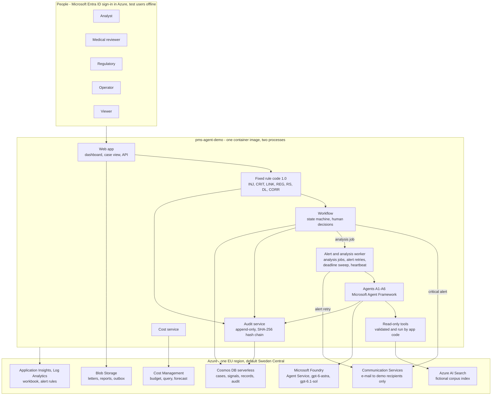
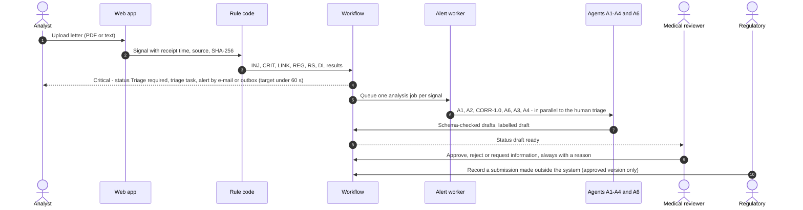

# Architecture

This page describes the components, the path of a letter through the system, case statuses, roles, the
audit trail, the two operating modes, telemetry, cost monitoring and the Well-Architected alignment.
It follows the approved design concept v1.1 (German), sections 6 to 10 and 15. Decisions are recorded
as [ADR-001 to ADR-011](adr/). Rule constants and their legal sources are in
[rule-sources.md](rule-sources.md).

> Synthetic data only. The demo illustrates workflows; it makes no statement about conformity with MDR,
> UK MDR, ISO 13485, GAMP 5 or any other requirement, and it is not a medical device. Only the medical
> reviewer decides. Nothing is ever sent to an authority.

## Contents

- [Overview](#overview)
- [Components](#components)
- [Agents and autonomy](#agents-and-autonomy)
- [Fixed rule code (rule package 1.0)](#fixed-rule-code-rule-package-10)
- [Path of a letter (critical first)](#path-of-a-letter-critical-first)
- [Extended analysis and correlation (R-15)](#extended-analysis-and-correlation-r-15)
- [Case statuses](#case-statuses)
- [Roles and permissions](#roles-and-permissions)
- [Audit trail](#audit-trail)
- [Case report](#case-report)
- [Dashboard and case work](#dashboard-and-case-work)
- [HTTP API](#http-api)
- [Offline mode and Azure mode](#offline-mode-and-azure-mode)
- [Azure resources](#azure-resources)
- [Data layout in Azure](#data-layout-in-azure)
- [Identity and access](#identity-and-access)
- [Telemetry, alert rules and workbook](#telemetry-alert-rules-and-workbook)
- [Governance](#governance)
- [Cost monitoring](#cost-monitoring)
- [Well-Architected alignment](#well-architected-alignment)
- [Configuration](#configuration)
- [Decisions](#decisions)

## Overview

The application is one Python service (Python 3.12, server-rendered pages, no front-end build). It
contains intake and text extraction, the fixed rule code, the workflow, the audit service, the alert
worker, the dashboard and the report export. The agents run behind one interface: in Azure through
Microsoft Agent Framework with Microsoft Foundry (Foundry Agent Service), offline through a
deterministic stand-in with fixed, versioned answers. Offline, data live in SQLite and the file system;
in Azure in Cosmos DB and Blob Storage.

- Intake: upload through the dashboard or the API, or seed import; every signal gets a receipt time
  (UTC), a source and a SHA-256 hash.
- The rule code runs before every agent and independently of it. No agent can overwrite its results.
- Agents receive the letter text only as a bounded data block, use only read-only function tools that
  the app code checks and executes, and return schema-checked JSON.
- Further sources come from a fictional, versioned knowledge corpus in Azure AI Search (offline: SQLite
  FTS5). A6 calls the search as a read-only tool.
- Models: gpt-6-astra for A3 and A6, gpt-6.1-sol for A1, A2 and A4, each Data Zone Standard EU
  ([ADR-002](adr/ADR-002.md)).
- The workflow is a fixed state machine; human actions run only through role-checked API endpoints.
- Every step writes exactly one audit record.

## Components

| Component | Responsibility | Code |
|---|---|---|
| Web app | Pages (dashboard, case, rejected, unreadable and unmatched, trend, costs, governance, audit trail), JSON API, upload, human actions; standard-library HTTP server (WSGI) with same-origin protection of every state change; in Azure behind Container Apps built-in authentication | `src/pms/web/`, `python -m pms serve` |
| Authentication | Who is calling: local test users (user picker cookie or `X-Demo-User` header) offline; the Microsoft Entra principal with its app roles in Azure. What the caller may do is decided only by the workflow's role matrix | `src/pms/auth.py` |
| Alert and analysis worker | Runs one analysis job per signal (agents and CORR-1.0); delivers alerts again when a first delivery failed; sweeps the deadline windows (raise-only); writes a heartbeat and runs periodic audit-chain checks. Offline a thread in the web process; in Azure its own container app with exactly one replica (`WORKER_MODE=separate`). Jobs survive restarts. | `python -m pms worker`, `src/pms/pipeline.py`, `src/pms/jobs.py` |
| Rule engine | Fixed rule code: INJ, extraction, CRIT, LINK, REG, RS, DL; CORR for correlation | `src/pms/rules/` |
| Workflow | Fixed state machine; permission checks; reason rules; version-bound approvals | `src/pms/workflow.py` |
| Audit service | Append-only records with a SHA-256 hash chain; verification | `src/pms/audit.py` |
| Store | SQLite offline; Cosmos DB and Blob Storage in Azure (shared by the web and the worker container; analysis jobs in `records`) | `src/pms/store.py`, `src/pms/azure/cosmos_store.py`, `src/pms/azure/blob_store.py` |
| Agents | A1 to A6 behind one interface; offline stand-in and Foundry adapter | `src/pms/agents/` |
| Knowledge index | Read-only search over the fictional corpus with an allow-listed query contract; SQLite FTS5 offline, Azure AI Search in Azure | `src/pms/knowledge.py`, `src/pms/azure/search.py` |
| Notifications | Outbox folder offline; Communication Services e-mail in Azure, sent by a background thread (never inside an upload) and retried by the worker | `src/pms/notify.py` |
| Costs and governance | Token costs per run and case, platform costs and forecast, budget; versions and controls view | `src/pms/costs.py`, `src/pms/governance.py` |
| Reports | Case report in Markdown and JSON | `src/pms/reports.py` |
| Golden run | Offline end-to-end run over all letters and seeds; compares every rule-based field with `expected.json` and checks alert timings, report completeness and the audit chain | `src/pms/golden.py`, `src/pms/golden_e2e.py`, `python -m pms golden` |
| Smoke test | Live checks against the Azure deployment in two parts (Gate C) | `src/pms/smoke.py`, `python -m pms smoke-test` |

The rule engine, workflow, audit service, store and golden comparator use the Python standard library
only. Azure packages are imported lazily inside the Azure adapters.

## Agents and autonomy

| ID | Agent | Autonomy | Model (Azure) | Task | Limits |
|---|---|---|---|---|---|
| A1 | Signal ingestion (reads the letter) | L4 according to Case Study 5 | gpt-6.1-sol | Reads the extracted text; returns structured facts (patient pseudonym, product, lot, UDI, dates, event, outcome, place), each with a verbatim quote; reports its own urgency suspicion (raise only) | No decision; quotes are checked deterministically against the source text; missing values stay empty = unknown |
| A2 | Product and implant matching | below L4 (proposal) | gpt-6.1-sol | Proposes the product match and explains differences to the registry; uses the result of REG-1.0 | The match stays a proposal; a registry mismatch is always visible |
| A3 | Medical analysis and causality | L2 (recommendation) | gpt-6-astra | Draft: causality on the 4-level MDCG 2020-10/1 scale (not related, possible, probable, causal); product defect possible yes/no/unclear; uses the correlation of A6; expected or unexpected according to the dossier; evidence for and against; uncertainty; missing data; IMDRF code candidates from a limited list; optional hint "check FSCA" | Recommendation only; may only raise urgency; never decides reportability |
| A4 | Vigilance reporting | below L3 (drafts only) | gpt-6.1-sol | Draft report text per rule set and a deadline overview from DL-1.0 and RS-1.0 | No submission, no sending; deadlines come only from the rule code |
| A5 | Light trend view | below L4 (display only) | no model | The six synthetic monthly rows (2026-04 to 2026-09) with unit, period and missing denominator | No statistical statement, no signal score; note "interpretation only by humans" |
| A6 | Evidence and correlation | L2 (recommendation) | gpt-6-astra | Derives targeted searches from the findings of A1 to A3 and calls the search tool (source type, model, lot, event term, period); the app runs the search read-only; A6 correlates hits, agreements and contradictions with quote and source ID | Read-only tools through the app code, no internet; at most two rounds and eight tool calls; may only raise urgency; "no hits" is not an all-clear; no statistics |

Case Study 5 names L4 for signal ingestion, L4 with reviewer notification for trend and signal
detection, L2 for causality assessment, L3 for vigilance reporting (submission only after reviewer
approval) and L3 for PSUR authoring. The demo stays at or below these levels for every agent; submission
and PSUR are left out. A6 supports the causality assessment and stays at L2 like it. Critical
detection, deadlines and the correlation index are rule code, not agents.

Read-only function tools (`src/pms/agents/tools.py`): `search_corpus` (knowledge search contract),
`get_registry_entry`, `get_dossier_item`, `get_past_case` (fictional past cases and human-approved
findings only, never drafts) and `list_case_signals` (signals of the analysed case, without letter
text). The app validates every argument against an allow-list, runs the call itself and writes one
`TOOL_CALL` audit record per attempt, refused calls included. Limits per agent run: at most 8 calls,
2 rounds and 5 calls per round (A-12). There is no tool that writes, sends or decides.

Every AI output is schema-checked, labelled "draft" and logged with its versions. The offline stand-in
is labelled "offline stand-in"; it includes a deliberately wrong "not serious" answer for letter L07
that must not lower urgency (test T04).

## Fixed rule code (rule package 1.0)

| Rule | Purpose | Logic (short) |
|---|---|---|
| CRIT-1.0 | Critical detection | Raw-text scan in DE, EN, FR and IT for death, serious public health threat and serious deterioration; also critical when the earliest deadline is due within 48 hours (pilot). No negation logic: in doubt critical. The AI reading is a second detector and may only raise. Only the medical reviewer lowers urgency, with a reason. |
| DL-1.0 | Deadlines | Anchor = earliest receipt of any signal of the case (day 0, calendar date Europe/Dublin). Day 1 starts the next day at 00:00:01; day N ends at 23:59:59. Candidates: public health threat 2 days; death 10 days; serious deterioration 10 days until a human classifies it as anticipated (then 15); otherwise provisionally 15. Every deadline per rule set is shown; the earliest drives priority. No working-day extension. Overdue when the clock is not stopped. The clock stops only through a recorded submission. Follow-ups and duplicates never reset the anchor. |
| RS-1.0 | Rule set and authority label | Incident state from the letter, else implant site in the registry, else sender country. EU states: EU MDR with the authority of the incident state. Northern Ireland: EU MDR, MHRA, MORE with the EU form. England, Scotland, Wales: UK MDR Part 4A, MHRA, MORE with the GB form. GB or NI unclear: both rule sets with their own deadlines. Authorities are labels only; FR shows "route unverified". |
| LINK-1.0 | Duplicates and follow-ups | Duplicate: same sender reference, or same patient pseudonym with the same product and event. Follow-up: a follow-up marker and a resolvable reference. Seeds: `previous_message_id` and `duplicate_of_message_id`. Every signal stays visible; the anchor stays. |
| REG-1.0 | Registry check | Deterministic comparison of patient pseudonym, lot and UDI-DI with the fictional registry. Result `MATCH`, `MISMATCH`, `NO_IDENTIFIERS` or `NOT_FOUND`; every difference is shown with field and value. |
| CORR-1.0 | Correlation index | Event terms in DE, EN, FR and IT assign event groups. The code searches the corpus, the registry and all cases for the same lot, the same model and the same family with the same event term, and shows hits with source ID. Counts and named matches only; a match can only raise urgency; no hits is not an all-clear. |
| INJ-1.0 | Prompt-injection detection | Pattern check in DE, EN, FR and IT for instructions addressed to systems. A hit sets a visible flag and an audit record; the labels stay unchanged. |

Every rule carries a version number that appears in every audit record and case report
(`src/pms/versions.py`). Sources: [rule-sources.md](rule-sources.md).

## Path of a letter (critical first)

1. **Intake.** Upload (analyst) or seed import (operator): a signal with receipt time (UTC), source and
   SHA-256 hash; one audit record.
2. **Text extraction.** If the text cannot be extracted, the status is `NICHT_LESBAR` (unreadable) with a
   visible task. Nothing is dropped.
3. **Rule code before any agent run:** INJ-1.0, CRIT-1.0, LINK-1.0, REG-1.0, RS-1.0, DL-1.0. A critical
   result sets `TRIAGE_ERFORDERLICH` (triage required) and creates a triage task, a dashboard alert and
   an e-mail (Azure) or an outbox entry (offline) – target under 60 seconds (pilot) – **before the
   analysis finishes.**
   - Every critical letter gets its own triage task and alert, also a duplicate, follow-up or copy that
     lands in a case that is already critical. The alert then reads "new signal on critical case …" (with
     the injection flag, it says that embedded instructions were ignored and withheld from the agents),
     and the case shows *Triage required* again. The deadline anchor stays.
4. **Agents A1, A2, A3 and A4** run in parallel to the triage. Every output is schema-checked, labelled
   as a draft and logged with its versions. A1 and A3 can only raise urgency.
   - 4a. **Extended analysis (R-15):** CORR-1.0 searches the corpus, the registry and all cases; A6 calls
     the search tool, the app checks and runs the search, A6 correlates, A3 updates the recommendation
     (at most two rounds).
   - In this implementation the alert is recorded in the same step as the rule results. Offline it is
     written to the outbox right away; in Azure the upload hands the e-mail to a background thread and
     returns at once, and the worker retries a delivery that is late or failed. One queued analysis job
     per signal runs A1, A2, CORR-1.0, A6, A3 and A4 in this order (at most two A6/A3 rounds) while the
     case waits for the human triage.
5. **Draft ready** (`ENTWURF_BEREIT`): the medical reviewer takes over, checks, and approves, rejects or
   requests information – always with a reason. An approved assessment becomes a finding in the findings
   store.
6. **Submission recorded:** a user with the regulatory role records a submission made outside the system,
   only for the approved version; this stops the clock. Nothing is sent.
7. The **case report** can be exported at any time; the audit chain can be verified at any time.

## Extended analysis and correlation (R-15)

On 10 Nov 2026 the project owner asked that agents do not assess a signal in isolation, but run further
medical analysis and draw on and correlate further sources. The demo implements this with agent A6, a
fictional knowledge corpus, a findings store and rule CORR-1.0.

| Source | Content in the demo | Status and limit |
|---|---|---|
| Literature | 9 fictional summaries (LIT-001 to LIT-009) on leaflet tear, endocarditis, stem fracture, liner dissociation, valve thrombosis, squeaking, ceramic head fracture, radiolucent lines and cup loosening | Invented and labelled; no real publication, journal or person (K-14, OI-027) |
| Past cases and findings | 5 closed fictional cases (H-001 to H-005) with a human-approved assessment; assessments approved in the demo are added continuously | Only human-approved assessments count as findings; drafts stay "draft" |
| Process findings | demo-finding-01 to -03 from the scenario, status Open | Taken over unchanged; only humans close them |
| Product data | Dossiers in IFU and SSCP style, fictional registry | As in the golden set |
| Technical documents | 5 fictional excerpts (TD-001 to TD-005): lot release, design verification, risk management, lot history, IFU revisions | Invented and labelled |
| Further sources | Synthetic monthly counts, IMDRF candidate list (only the codes used) | Counts only, no rates |

Analysis loop:

1. A1 to A3 create the initial assessment of the signal; triage and deadlines run before and
   independently of it.
2. CORR-1.0 searches deterministically for the same lot, the same model and the same product family with
   the same event term in the corpus, the registry and all cases.
3. A6 calls the search tool, at most eight calls per run (source type, family, model, lot, event term,
   period, short search text). The app checks the parameters against an allow-list and queries Azure AI
   Search read-only (offline: SQLite FTS5).
4. A6 correlates the hits: agreements, contradictions and open questions, each with source ID and verbatim
   quote. The code checks every quote against the source.
5. A3 updates causality, "product defect possible", evidence for and against, and open questions. At most
   two rounds, then hand-over to the reviewer.
6. Every query, hit and correlation is logged with the corpus version and appears in the case report.

Guardrails: the extended analysis never delays triage, alert or deadlines and can only raise urgency;
"no hits" never means "harmless"; no rates, scores, significance or trend statements; letter content does
not steer any search; no internet, no literature database, no tools that write or send; every tool call
is audited; a corpus change flags all assessments that used the affected sources for re-review.

## Case statuses

Status identifiers are the German identifiers of the concept; the UI shows the English labels.

| Status | English label | Meaning | Set by |
|---|---|---|---|
| `EINGEGANGEN` | Received | Signal received, text extracted | System |
| `NICHT_LESBAR` | Unreadable | Text could not be extracted; visible task | System |
| `TRIAGE_ERFORDERLICH` | Triage required | Detected as critical; triage task and alert; analysis runs in parallel | System (raise only) |
| `IN_ANALYSE` | In analysis | Agents A1 to A4 are running | System |
| `ENTWURF_BEREIT` | Draft ready | A recommendation draft is available | System |
| `IN_MEDIZINISCHER_PRUEFUNG` | In medical review | The reviewer has taken over the case | Medical reviewer |
| `RUECKFRAGE` | Information requested | Missing data requested | Medical reviewer |
| `FREIGEGEBEN` | Approved (this version) | Recommendation approved in exactly this version | Medical reviewer (with reason) |
| `ABGELEHNT` | Rejected | Recommendation rejected, with reason code and reason | Medical reviewer (with reason) |
| `MELDUNG_ERFASST` | Submission recorded | Human-recorded submission made outside the system | Regulatory (approved version only) |
| `ABGESCHLOSSEN` | Closed | Case closed | Medical reviewer (with reason) |
| `ABGESCHLOSSEN_NICHT_MELDEPFLICHTIG` | Closed as non-reportable | Case closed as not reportable | Medical reviewer (with reason) |

State-machine rules:

- The system sets only technical statuses and only raises urgency.
- A critical case stays in `TRIAGE_ERFORDERLICH` until a person (analyst or medical reviewer) takes over
  the triage; only a human moves it on. It then shows *Draft ready* when the analysis has finished, or
  *In analysis* while the agents are still running. One takeover closes all open triage tasks of the
  case; a further critical letter for the case sets *Triage required* again with a new task.
- Approve, reject, request information, close and "non-reportable" are set only by the medical reviewer,
  each with a reason; a rejection also needs a reason code.
- An approval is bound to the content hash of the reviewed version. Any later change (metadata, a new
  signal, a new agent run) voids the approval and returns the case to review.
- "Submission recorded" is set only by the regulatory role and only for the approved version. Date,
  channel label, reference and receipt status (confirmed or unconfirmed) are recorded. This stops the
  deadline clock; nothing is sent, not even in simulation.
- Closing as non-reportable does not stop the clock; the deadline is shown as "not applicable according
  to a human decision" with user and reason (decision Q-4).
- If data are missing, A3 drafts a targeted request to the sender (only the needed fields, with reasons).
  The draft is not sent; deadline monitoring continues.
- A follow-up to a closed case reopens it; it needs a new human triage.
- No timers: no status changes into a decision because a deadline is near or a person is absent.
- Reject reason codes: R1 insufficient evidence, R2 facts extracted incorrectly, R3 wrong product
  assignment, R4 causality not traceable, R5 rule set or deadline wrong, R6 other (free text mandatory).

## Roles and permissions

| Action | Not signed in | Viewer | Analyst | Regulatory | Medical reviewer | Operator | Agent or system |
|---|---|---|---|---|---|---|---|
| View cases and signals | no | yes | yes | yes | yes | yes | internal |
| Upload a letter, add a signal to a case | no | no | yes | yes | yes | no | no |
| Edit metadata (reason required) | no | no | yes | yes | yes | no | no |
| Request a new analysis | no | no | yes | no | yes | no | no |
| Take over triage | no | no | yes | no | yes | no | no |
| Raise urgency | no | no | yes | yes | yes | no | yes (rule or AI) |
| Lower urgency (reason required) | no | no | no | no | yes | no | no |
| Approve, reject, request information, close | no | no | no | no | yes | no | no |
| Close as non-reportable | no | no | no | no | yes | no | no |
| Record a submission (approved version only) | no | no | no | yes | no | no | no |
| View costs and governance | no | yes | yes | yes | yes | yes | no |
| Withdraw a finding or close a process finding (reason required) | no | no | no | no | yes | no | no |
| Load demo data or start a new demo run | no | no | no | no | no | yes | no |
| Change or delete audit records | no | no | no | no | no | no | no |

In Azure, roles come from Entra app roles (`PMS.Viewer`, `PMS.Analyst`, `PMS.Regulatory`,
`PMS.MedicalReviewer`, `PMS.Operator`). Locally there is one test user per role (`viewer`, `analyst`,
`regulatory`, `reviewer`, `operator`), only when `APP_ENV=local`. The app refuses to start in Azure when
`LOCAL_TEST_USERS` is active. Agents and the system have no decision rights; an attempt is refused and
logged (`ACCESS_DENIED`).

The eight human approval steps of the regulatory analysis (p. 16) and how the demo treats them:

| Step | Content | In the demo |
|---|---|---|
| HA-1 | Serious-incident and reportability decision | Medical reviewer only (workflow and roles) |
| HA-2 | Causality, awareness date and reportability date | The system only proposes the earliest anchor; humans decide |
| HA-3 | Benefit-risk and trend interpretation | Counts only; every interpretation by humans; benefit-risk not in the demo |
| HA-4 | CAPA or FSCA decision and FSN risk wording | Only the hint "check FSCA" as a draft |
| HA-5 | PMCF and PSUR conclusion | Out of scope: PSUR authoring is roadmap only; PMCF is not part of the demo; no such output is produced |
| HA-6 | Final submission to an authority or notified body | No submission; status "submission recorded" only by humans |
| HA-7 | Closing a case as non-reportable | Medical reviewer only |
| HA-8 | Any change of regulatory master data or an approved report | Audited; a rule-set change only as a new version with a change list |

## Audit trail

The audit service writes exactly one record for every status change, agent run, human decision and
metadata edit. Records are only appended; there is no API to change or delete them.

| Field | Content |
|---|---|
| `record_id`, `seq` | Unique ID and running number in the chain |
| `ts_utc` | Time in UTC (ISO 8601 with milliseconds) |
| `source` | Origin: `upload`, `seed`, `rule`, `agent`, `ui`, `api`, `system` |
| `actor_type`, `actor_id` | `human`, `agent`, `rule` or `system`; Entra object ID, test user or agent ID |
| `agent_version`, `model`, `model_version`, `prompt_version` | For agent runs |
| `rule_versions` | For rule evaluations, for example `CRIT-1.0`, `DL-1.0`, `CORR-1.0` |
| `corpus_version`, `source_ids` | For research and correlation: corpus version and the source IDs used |
| `usage`, `cost_estimate` | For agent runs: token usage (input, cached, output) and estimated cost with the price-table version |
| `event_type` | For example `STATUS_CHANGED`, `AGENT_RUN`, `TOOL_CALL`, `RETRIEVAL_RUN`, `CORRELATION_RUN`, `DECISION`, `FINDING_CREATED`, `METADATA_EDITED`, `SIGNAL_ADDED`, `ALERT_SENT`, `COST_RECORDED`, `ACCESS_DENIED` |
| `case_id`, `signal_id` | Reference |
| `before`, `after` | Values before and after the change |
| `reason` | Reason; mandatory for human decisions and metadata edits |
| `app_version` | Application version (implementation addition, design element D-21) |
| `prev_hash`, `hash` | SHA-256 over the previous hash and the canonical record |

- The implementation uses a closed vocabulary of event types (`EVENT_TYPES` in `src/pms/audit.py`); in
  addition to the examples above it contains, for example, `RULE_EVALUATED`, `CASE_CREATED`,
  `TASK_CREATED`, `URGENCY_RAISED`, `URGENCY_LOWERED`, `APPROVAL_VOIDED` and `SUBMISSION_RECORDED`.
- Offline, SQLite triggers abort every `UPDATE` and `DELETE` on the audit table. In Azure, the app writes
  the `audit` container with a custom data role that allows create and read but no replace, upsert or
  delete.
- `verify-audit` recomputes the chain and reports the first break: `bash scripts/verify-audit.sh`
  (offline) or `bash scripts/verify-audit.sh --azure`. A negative test changes one record directly in
  the database and expects the check to fail.
- **Limit:** the chain makes changes detectable. An owner of the subscription (or of the local database
  file) can still delete resources or the whole store.

## Case report

Every case can be exported as a report in Markdown and JSON (`GET /api/cases/{id}/report?format=md` or
`format=json`). Mandatory content:

- all signals, including duplicates and follow-ups, with receipt time and source;
- facts with the source text they come from;
- matched implant and product data with the result of the registry check;
- the recommendation with the causality rating (4-level scale of MDCG 2020-10/1) and IMDRF code
  candidates;
- evidence for and against;
- uncertainty and missing data;
- further sources and correlations used, with source ID, quote and corpus version;
- costs of the case: tokens per agent, estimated model costs and the date of the price table;
- the versions used (app, model, prompt, rules, corpus) and the reviewer's decision.

## Dashboard and case work

The web app (`src/pms/web/`) renders its pages on the server with the standard library; a small script
refreshes the dashboard and the countdowns. Every page carries the disclaimer banner (English and the
German text of the concept) and the navigation *Dashboard, Rejected, Unreadable & unmatched, Trend,
Costs, Governance, Audit trail*. The UI is in English like the repository; decisions are never shown by
colour alone, and every action has a clear label.

| Page | Content |
|---|---|
| `/` Dashboard | Counts (cases, critical, overdue, analyses pending, rejected, unreadable or unmatched); the **critical queue first**, sorted by the earliest deadline, with countdown and OVERDUE marks; other current cases and closed cases with status and the progress of each step (A1, A2, CORR-1.0, A6, A3, A4: done, running, queued, failed, not started); the A5 trend panel; *Upload a letter* (file `.txt`/`.pdf` or pasted text, optional receipt time); *Load demo data* (operator; messages already loaded are skipped) |
| `/cases/{id}` | Summary and the callout "waiting for a person to take over the triage" for critical cases; actions; agent progress; deadlines per rule set (countdown, status, "entfällt laut menschlicher Entscheidung" when waived); all signals with the original letter text (paragraphs flagged by INJ-1.0 are marked and withheld from the agents), relation (new case, duplicate, follow-up) and registry check; facts with source quotes; matched implant and product data; the draft recommendation (causality, product defect possible, evidence for and against, uncertainty, missing data, IMDRF candidates with attribution); correlation with sources, agreements, contradictions and gaps, drafts and approved findings kept apart; report drafts; decisions; metadata edits (user, old and new value, reason); tasks and alerts; agent runs with versions, tokens and costs; the audit history of the case |
| `/rejected` | Rejections with reason code (R1 to R6, legend on the page), reason, reviewer, time and current status |
| `/unreadable` | Unreadable inputs (UNREADABLE) and inputs whose product or patient could not be matched (UNMATCHED), each with its open task |
| `/trend` | Unit, period, denominator ("unknown"), source and the six synthetic monthly rows; the note "interpretation only by humans, no rates" |
| `/costs` | Model costs per agent and model and per case (tokens times the dated price table), platform costs so far, forecast for the next month and budget status, each with source and data date; offline the platform figures are labelled "simulated" |
| `/governance` | Versions (app, rules, corpus, models, prompts, agents), evaluation status, open human decisions, deadlines, audit status, region policy, references to the workbook and the traces, process findings (the medical reviewer updates them with a reason) |
| `/audit` | The newest audit records (300 by default) with filters for case, event type and number, and the result of the chain check |
| `/login` | Offline: the user picker – one button per local test user with the actions of its role. Azure: a link to the Microsoft Entra sign-in |

Actions on the case page (each one checked by the role matrix on the server; a refused attempt is
recorded as `ACCESS_DENIED`; the page shows which roles may do what):

| Action | Button | Who |
|---|---|---|
| Add a signal to this case | *Add signal* | analyst, regulatory, medical reviewer |
| Edit metadata (reason required) | *Save change* | analyst, regulatory, medical reviewer |
| Take over the triage | *Take over the triage* | analyst, medical reviewer |
| Take over the medical review | *Take over the review* | medical reviewer |
| Decision: approve this version, reject (R1 to R6), request information, close, close as non-reportable (reason required) | *Record decision* | medical reviewer |
| Raise urgency | *Raise urgency* | analyst, regulatory, medical reviewer |
| Lower urgency (reason required) | *Lower urgency* | medical reviewer |
| Classify a serious deterioration as anticipated (reason required) | *Classify as anticipated* | medical reviewer |
| Re-run the analysis | *Re-run the analysis* | analyst, medical reviewer |
| Record a submission made outside the system (approved version only) | *Record submission - nothing is sent* | regulatory |

Editable metadata fields: `product_family`, `model`, `lot`, `udi_di`, `patient_reference`,
`incident_state`, `event_date`, `implant_date`, `implant_site`, `reporter_reference`, `outcome`, `note`.
An empty value means unknown.

## HTTP API

All pages and endpoints need a signed-in user except `/healthz`, `/login`, `/logout` and the static
files. Responses of `/api/...` are JSON; errors are JSON objects with `error`, `reason` and `status`.

| Method and path | Purpose | Who |
|---|---|---|
| `GET /healthz` | Health, versions, worker mode | anyone |
| `GET /login`, `POST /login` (`user`, `next`), `POST /logout` | Offline user picker; sets or clears the cookie `pms_demo_user`. In Azure `/logout` leads to the Entra sign-out | anyone |
| `GET /`, `/cases/{id}`, `/rejected`, `/unreadable`, `/trend`, `/audit` | Pages | signed-in users |
| `GET /costs`, `/governance` | Pages | signed-in users (all five roles) |
| `GET /api/me` | Your user, roles and the actions you may do | signed-in users |
| `GET /api/cases` | Dashboard data: critical queue, cases, rejected, unreadable and unmatched, counts | signed-in users |
| `GET /api/cases/{id}` | Case with signals, deadlines, decisions, approvals, alerts, tasks, audit records | signed-in users |
| `GET /api/cases/{id}/progress` | Status, analysis state and the progress of each step | signed-in users |
| `GET /api/cases/{id}/report?format=json` or `format=md` | Case report (JSON default, Markdown) | signed-in users |
| `GET /api/rejected`, `/api/unreadable`, `/api/trend` | List views | signed-in users |
| `GET /api/governance`, `/api/costs` | Governance and cost data | signed-in users |
| `GET /api/audit?case_id=&event_type=&limit=` | Audit records (append-only; no API changes or deletes them) | signed-in users |
| `GET /api/audit/verify` | Recompute the hash chain: `ok`, records checked, first break | signed-in users |
| `GET /api/outbox` | Local outbox entries (offline only; `404` in Azure) | signed-in users |
| `POST /api/letters` | Upload: JSON `filename` and `text` or `content_base64`, optional `received_at`, or a form with a file; `201` with case, signal, critical flag and alerts. Critical detection runs before any analysis | analyst, regulatory, medical reviewer |
| `POST /api/cases/{id}/signals` | Add a signal to a case (same body as an upload) | analyst, regulatory, medical reviewer |
| `POST /api/cases/{id}/metadata` | `field`, `new_value`, `reason` (required) | analyst, regulatory, medical reviewer |
| `POST /api/cases/{id}/triage` | Take over the triage (optional `reason`) | analyst, medical reviewer |
| `POST /api/cases/{id}/review` | Take over the medical review | medical reviewer |
| `POST /api/cases/{id}/urgency` | `direction` = `raise` (optional reason) or `lower` (reason required) | raise: analyst, regulatory, medical reviewer; lower: medical reviewer |
| `POST /api/cases/{id}/decision` | `decision` = `approve`, `reject`, `request_info`, `close` or `non_reportable`; `reason` required; `reason_code` `R1`-`R6` for a rejection | medical reviewer |
| `POST /api/cases/{id}/anticipated` | Classify a serious deterioration as anticipated (`reason`); adds the 15-day candidate, the 10-day one stays visible | medical reviewer |
| `POST /api/cases/{id}/reanalysis` | Queue a new analysis (`202`); voids an approval | analyst, medical reviewer |
| `POST /api/cases/{id}/submission` | `channel_label`, `reference`, `submitted_on`, `receipt_status` (`confirmed` or `unconfirmed`), optional note; records a submission made elsewhere and stops the clock – never sends | regulatory (approved version only) |
| `POST /api/findings/{id}` | Change the status of a finding or process finding (`status`, `reason`) | medical reviewer |
| `POST /api/seed` | Load the demo data (idempotent) | operator |

Status codes: `401` not signed in, `403` the role may not do this (recorded as `ACCESS_DENIED`), `400`
missing reason or invalid value, `404` unknown case, `409` the action does not fit the case status,
`413` or `400` for a refused upload (larger than 5 MiB, unknown type), `415` unsupported body type.

Sign-in on requests:

- **Offline** (`APP_ENV=local` and `LOCAL_TEST_USERS=true`): the cookie `pms_demo_user` set by the user
  picker (`HttpOnly`, `SameSite=Strict`) or the header `X-Demo-User: <user>` for scripts. Users:
  `viewer`, `analyst`, `regulatory`, `reviewer` (medical reviewer), `operator`.
- **Azure**: Container Apps built-in authentication validates the Microsoft Entra sign-in (browser session
  or bearer token) and passes the principal (`X-MS-CLIENT-PRINCIPAL`) with its claims to the app. The app
  maps the app roles `PMS.Viewer`, `PMS.Analyst`, `PMS.Regulatory`, `PMS.MedicalReviewer` and
  `PMS.Operator` to its roles; demo-user header and cookie are ignored; no principal means `401`. Scripts
  send an Entra access token (`Authorization` header) that they get from the Azure CLI; the token is never
  printed.

Protection of state changes: only `POST`, with a JSON body (`Content-Type: application/json`) or a form
posted from the app's own pages (same-origin check of `Origin` or `Referer`); cross-site requests are
refused (`403`), other body types get `415`. Responses carry a strict Content Security Policy,
`X-Frame-Options: DENY`, `X-Content-Type-Options: nosniff` and `Cache-Control: no-store`. The app can also
run under a WSGI server (`pms.web.app:application`); it refuses to start with unsafe settings.

## Offline mode and Azure mode

| Aspect | Offline (local) | Azure |
|---|---|---|
| Agents | Deterministic stand-in with fixed answers and token counts, no network calls | Microsoft Agent Framework with Foundry Agent Service; gpt-6-astra and gpt-6.1-sol (Data Zone Standard EU) |
| Knowledge corpus and search | Files in the repository, index in SQLite FTS5 | Azure AI Search (Basic), index built from the same corpus |
| Monitoring | Agent-run spans written to a local file (`DATA_DIR/traces/agent-spans.jsonl`), same attributes | Foundry tracing, Application Insights, workbook, alert rules |
| Costs | Simulated, labelled cost data | Token costs, Cost Management APIs, budget |
| Data | SQLite and file system (`DATA_DIR`, default `./var`) | Cosmos DB serverless (`cases`, `signals`, `records`, `audit`) and Blob Storage (`letters`, `reports`, `outbox`), shared by the web app and the worker |
| Audit | SQLite with triggers against change and delete | Cosmos container with a data role without replace and delete |
| Identity | Local test users per role, only with `APP_ENV=local`: user picker (`/login`, cookie) or header `X-Demo-User` | Sign-in only through Microsoft Entra ID (Container Apps built-in authentication, single tenant), Entra app roles |
| Notification | Outbox folder `DATA_DIR/outbox` (one `.eml` and one `.json` file per alert), written right after the rule code | Communication Services e-mail to configured demo recipients, sent by a background thread (never inside the upload request) and retried by the worker; a copy of each message in the Blob container `outbox` |
| Secrets | None | None in the repository; managed identities; Key Vault only as a fallback (empty by default) |
| Start | `bash scripts/run-local.sh` (`--port` to change port 8000) | `azd up` or `bash scripts/deploy.sh` |
| Processes | Web app with in-process worker (`WORKER_MODE=inprocess`) | Two container apps from one image: web (`PMS_ROLE=web`) and worker (`PMS_ROLE=worker`) |

## Azure resources

All resources are in one resource group `rg-<environment name>` in one EU region (default Sweden
Central; preflight fallback Germany West Central). Tags: `azd-env-name`, `workload`, `cost-center`.

| Resource | Purpose | Configuration |
|---|---|---|
| Microsoft Foundry account and project (`proj-pms-demo`) | Foundry Agent Service and model deployments | gpt-6-astra (2026-09-03) and gpt-6.1-sol (2026-09-29), Data Zone Standard, no automatic version upgrade; fallback gpt-6.1-sol for all agents; local (key) authentication disabled; content filter with Prompt Shields; connected to Application Insights for tracing |
| Azure AI Search | Index of the fictional corpus (`pms-knowledge`) | Basic, one search unit; key authentication disabled; access through managed identity (OI-035) |
| Container Apps environment and two apps | Web app and alert worker | Consumption workload profile; web: external HTTPS ingress, built-in Entra authentication, 0 to 3 replicas; worker: no ingress, exactly 1 replica (needed for the 60-second alert); health probes on `/healthz` |
| Azure Container Registry | Container image (built remotely in the registry, no local Docker needed) | Basic (approved, Q-6); admin user and anonymous pull off |
| Cosmos DB for NoSQL | Database `pms` with the containers `cases`, `signals`, `records` and `audit` (partition key `/pk`) | Serverless; local keys disabled; audit role create and read only; see [Data layout in Azure](#data-layout-in-azure) |
| Storage account | Blob containers `letters`, `reports` and `outbox` (copies of the alert e-mails) | No public access; shared key disabled; TLS 1.2; soft delete 7 days; access through managed identity |
| Key Vault | Only if a secret ever becomes unavoidable | RBAC mode; soft delete and purge protection; empty by default |
| Log Analytics and Application Insights | Tracing and monitoring | Pay-as-you-go; retention 30 days; daily cap 1 GB; resource-permission access |
| Azure Monitor workbook and alert rules | Operations overview and alerts | Through Bicep ([ADR-009](adr/ADR-009.md)) |
| Budget | Cost notifications | Resource group, default 250 USD per month ([ADR-010](adr/ADR-010.md)) |
| Azure Policy assignments | Only the selected region allowed (enforced); required tag `workload` (report only) | Resource group |
| Communication Services with Email | Alert e-mail | Azure-managed domain; data location Europe (OI-012) |
| Entra app registration | Sign-in and app roles | Microsoft Graph Bicep extension; fallback: bring your own registration (OI-013) |
| User-assigned managed identity | Access to Foundry, AI Search, Cosmos DB, Storage, Communication Services, registry and cost data | Least-privilege roles (table below) |

Outside the resource group: a custom role "PMS demo ACS e-mail sender" at subscription level (assignable
only to the demo resource group) and the Entra app registration. `scripts/teardown.*` removes both
(never a bring-your-own registration).

## Data layout in Azure

In Azure the web app and the worker share one store (`src/pms/azure/`); the repository code above them
is the same as offline. A separate worker (`WORKER_MODE=separate`) therefore needs `COSMOS_ENDPOINT` and
`COSMOS_DATABASE`; without them it refuses to start.

| Cosmos DB container | Documents | Partition key (`pk`) |
|---|---|---|
| `cases` | One document per case | case ID |
| `signals` | One document per signal (letter or seed message) | case ID |
| `records` | Every other table, typed by `type`: `tasks`, `alerts`, `deadlines`, `decisions`, `approvals`, `submissions`, `metadata_edits`, `findings`, `costs`, `agent_runs`, `recommendations`, `facts`, `correlations`; plus `analysis_jobs` (job queue), `counter` (ID counters), `meta`, `lease` (short write lease that serialises read-check-write steps across processes) and `foundry_agent_versions` (published prompt-agent versions) | case ID, or `global`, `counters`, `meta`, `leases`, `foundry-agents` |
| `audit` | The hash-chained audit trail; document `id` = sequence number; written with create only (the app's custom data role allows create and read, no replace, upsert or delete); a duplicate sequence number is rejected and the writer takes the next one | `audit-chain` |

- Single-document writes use optimistic concurrency (ETag); counters and job claims as well, so a job
  never runs twice. Cosmos DB has no multi-document rollback: a failure inside a step leaves the writes
  made so far; the audit chain stays valid.
- Blob Storage: `letters` (originals), `reports` (exported case reports) and `outbox` (a copy of every
  alert e-mail as `.eml` and `.json`); the template creates the three containers, and the app would create
  a missing one on first use. The app uses the Blob REST API with its Entra token; shared keys are disabled.
- Azure AI Search: the index `pms-knowledge` holds exactly the documents of the offline index (the
  fictional corpus plus the dossier side-effect items). The app creates and fills it with its Entra
  identity – at `python -m pms seed --index-only`, at every worker start and before the first query of a
  process. Documents are compared by content hash, so a sync is idempotent (`--force` uploads every
  document again). Filter-only queries give the same hits in the same order as offline, which keeps
  CORR-1.0 deterministic; text queries match the same documents, but the ranking can differ.

Background work in Azure:

| What | Who | Behaviour |
|---|---|---|
| Alert e-mail | Web app (sender thread) | The upload records the alert, the triage task and the audit record and returns at once (the response lists the alert as `QUEUED`; it stays `PENDING` until a delivery attempt). A background thread sends the e-mail (it waits at most 15 seconds for the service), records `SENT` or `FAILED` (one `ALERT_SENT` audit record per attempt) and keeps the copy in `outbox` |
| Alert retry | Worker | Picks up alerts that are still pending after 10 seconds and failed ones after 5, 15, 45 and 135 seconds; at most 5 attempts. A delivery claim (30 seconds) keeps two processes from sending the same alert |
| Analysis jobs | Worker | One job per signal: A1, A2, CORR-1.0, A6, A3, A4; jobs left running by a crashed worker are queued again |
| Deadline sweep | Worker | Every 60 seconds (offline: in every worker loop); raises urgency only |
| Heartbeat and audit check | Worker | Heartbeat about every minute, chain check every hour (telemetry below); the worker's `/healthz` answers `503` when its heartbeat is stale |
| Knowledge index and agents | Worker start (background) and the postdeploy hook | Sync of the search index; publishing of the Foundry prompt agents whose specification changed (prompt, model deployment, tools, response schema, project). Unchanged agents keep their version; a missing agent version is published again once |

Links in alert e-mails point to `PUBLIC_BASE_URL` + `/cases/<id>`; the templates set `PUBLIC_BASE_URL` to
the web address (`WEB_URL`). Without it the link is relative.

## Identity and access

Sign-in (requirement R-19, [ADR-005](adr/ADR-005.md)):

- Sign-in only through Microsoft Entra ID: Container Apps built-in authentication, single tenant,
  unauthenticated requests are redirected to the login page; only `/healthz` is anonymous.
- Rights come only from the app roles in the token. The enterprise application requires an assignment,
  so users without a PMS app role cannot sign in.
- No client secret (ID-token flow). Multi-factor authentication comes from the tenant's Conditional
  Access policies.
- No local accounts in Azure; the app refuses to start with `APP_ENV=azure` and `LOCAL_TEST_USERS=true`.

Azure RBAC of the app's user-assigned managed identity and of the deployer (least privilege):

| Principal | Role | Scope |
|---|---|---|
| App identity | Azure AI User | Foundry account |
| App identity | Search Index Data Reader; Search Index Data Contributor and Search Service Contributor (to create and fill the index when the demo data are loaded; parameter `appSearchWriteAccess`) | Search service |
| App identity | Storage Blob Data Contributor | Storage account |
| App identity | AcrPull | Container registry |
| App identity | Custom "PMS demo ACS e-mail sender" (no key listing) | Communication Services |
| App identity | Cost Management Reader | Resource group |
| App identity | Cosmos DB built-in Data Reader (account); Data Contributor on `cases`, `signals`, `records`; custom "PMS audit append-only" on `audit` | Cosmos DB |
| Deployer | Azure AI User (Foundry portal, traces, evaluations); optional read-only data roles | Resources |

## Telemetry, alert rules and workbook

The app writes log records whose attributes appear in `customDimensions` in Application Insights.
The alert rules and the workbook query these events.

| Event (`pms_event`) | Attributes | Written when | Used by |
|---|---|---|---|
| `ALERT_SENT` | `pms_latency_s`, `pms_case_id` | an alert for a critical case was delivered | alert rule "critical-case alert later than 60 seconds"; workbook "time to alert" |
| `AGENT_RUN` | `pms_status` (`ok` or `failed`), `pms_agent`, `pms_model`, `pms_duration_ms`, `pms_tokens_in`, `pms_tokens_out`, `pms_cost_usd` | every agent run | alert rule "failed agent runs"; workbook "agent runs", "tokens and cost" |
| `WORKER_HEARTBEAT` | – | by the worker about every minute (contract: at least every 5 minutes) | alert rule "alert worker heartbeat missing" (15 minutes without one) |
| `AUDIT_VERIFY` | `pms_status`, `pms_records` | hourly audit-chain check by the worker | alert rule "audit chain verification failed"; workbook "audit chain" |
| `CASE_OVERDUE` | `pms_case_id` | a deadline is overdue | workbook "overdue cases" |

- Four log alert rules run every 15 minutes (the cheapest frequency) and notify the action group
  (deployer e-mail). The budget sends its own notifications.
- The workbook *PMS agent demo – operations* shows agent runs, tokens and cost, time to alert, overdue
  cases, audit-chain status, worker heartbeat, errors and requests.
- Foundry tracing uses the connected Application Insights resource; spans carry case, agent, model,
  prompt, rule and corpus versions and token usage.
- Traces contain prompt content (synthetic data only). Read access is meant for the operator role
  (A-16, OI-033); in Azure, reading traces requires Azure RBAC on the monitoring resources. Retention is
  30 days.
- Offline, the records go to the standard log, and every agent run is also written as a span (one JSON
  line with the same attributes) to `DATA_DIR/traces/agent-spans.jsonl` (default `var/traces/`).
  Telemetry never carries letter text.

## Governance

| Area | In the demo | Status |
|---|---|---|
| Tracing | Foundry tracing through the connected Application Insights; the app sends spans with case, agent, model, prompt, rule and corpus version and token usage | generally available for prompt agents |
| Operations overview | Azure Monitor workbook through Bicep: agent runs, errors, latency, tokens, time to alert, overdue cases, audit-chain status | generally available |
| Alert rules | Alert latency above 60 seconds, failed agent runs, missing heartbeat of the alert worker, failed audit-chain check, budget levels | generally available |
| Policy | Azure Policy assignment on the resource group: only the selected EU region allowed; required tag for the demo | generally available |
| Content filter | Guardrails of the model deployments with Prompt Shields against direct and indirect attacks, in addition to rule INJ-1.0 | configuration to be confirmed in Stage 2 (OI-034) |
| Versions | Fixed model versions in Bicep, agent versions in Foundry, prompts in the repository, version manifest in audit and report | design element D-21 |
| Evaluation | Golden-set evaluation with Foundry evaluators (tool-call accuracy, task adherence, groundedness) plus a check of the causality ranges; result as Gate C evidence | test T30 |
| Governance view | In the app: versions, last evaluation status, open human decisions, deadlines, audit status, policy assignment | design element D-34 |
| Optional (preview) | Agent monitoring dashboard, continuous evaluation, red teaming, insights | off; enabled only after the project owner's decision (OI-032) |

## Cost monitoring

| Figure | Source and calculation | Label |
|---|---|---|
| Model costs per agent run | Token usage of the Responses API (input, cached, output including reasoning) times the dated price table (`config/pricing.json`, source and date) | measured; prices as of 10 Nov 2026 |
| Costs per case | Sum of the model costs of all agent runs of the case; separately a share of the fixed costs (platform costs of the month divided by the number of cases) | variable costs measured, fixed-cost share allocated |
| Platform costs so far | Cost Management Query API, resource group, start of month to today, by service | actual costs with data date (delay up to about one day) |
| Forecast for next month | Cost Management Forecast API, resource group, next calendar month; without a forecast, a simple projection from the daily average of the last 14 days | estimate with source |
| Budget | Budget of the resource group through Bicep, default 250 USD per month; notifications at 50, 80 and 100 percent actual and 100 percent forecast to the deployer address | parameter |

- The cost view shows platform and model costs, costs per agent and model, the forecast, the budget
  status and a table of costs per case; the case report states the costs of the case.
- The app's managed identity reads costs with Cost Management Reader on the resource group. If a
  subscription does not support the APIs, the app shows only the token costs and a notice (OI-030).
- Offline, the stand-in returns fixed token counts; platform costs and forecast are simulated and
  labelled "simulated".
- Cost values are kept apart from safety and trend views; they are no statistical statement about
  products (K-19).

## Well-Architected alignment

The demo follows the Azure Well-Architected Framework where it fits a self-deployed demo with synthetic
data; recommendations with extra cost or high effort are documented deviations with an option
([ADR-011](adr/ADR-011.md), K-21, OI-037). This illustrates the alignment; it is not a statement of
conformity.

| Pillar | Implemented | Deviation and option | Check |
|---|---|---|---|
| Reliability | Alert worker with at least one replica and health probes; retry with backoff for model and search calls; idempotent processing per signal; resume after a failure without lost deadlines; infrastructure as code with azd | No zone redundancy, no second region; option: zone-redundant environment and Cosmos DB | T25, T29, smoke test |
| Security | Entra-only sign-in with app roles; managed identities instead of keys; local authentication off where possible; Key Vault with RBAC, soft delete and purge protection; HTTPS only; least privilege; Prompt Shields; secret scan; OIDC deployment without stored secrets | Public endpoints protected by Entra ID instead of private networking; no Defender plans; option: VNet integration with private endpoints | T05, T11, T31, T32 |
| Cost optimization | Serverless and Basic tiers; budget with alerts; costs per case; forecast; cost tags; teardown script | Azure AI Search Basic is the largest fixed cost; tier is a parameter | T27, T28 |
| Operational excellence | Everything as code; CI with lint, tests, Bicep build and PSRule check; preflight and smoke test; diagnostics to Log Analytics; workbook and alert rules; versions in every audit record | No staging environment | T09, T10, T29, T31 |
| Performance efficiency | Container Apps scale with load; limits for tool calls, rounds and run time; alert latency is measured | No load tests | T04, T29 |

PSRule for Azure checks the templates in CI (pinned versions); every suppressed rule has a written reason
in `.ps-rule/waf-deviations.Rule.yaml`.

## Configuration

Environment variables of the app (set by the scripts offline and by Bicep in Azure):

| Variable | Meaning | Offline | Azure |
|---|---|---|---|
| `APP_ENV` | `local` or `azure` | `local` | `azure` |
| `AGENT_BACKEND` | `offline` or `foundry` | `offline` | `foundry` |
| `LOCAL_TEST_USERS` | Built-in test users; the app refuses to start with `azure` + `true` | `true` | `false` |
| `DATA_DIR` | Local data folder | `./var` | `/app/var` |
| `PORT` | HTTP port (`serve --port` overrides it) | `8000` | `8000` |
| `WORKER_MODE` | `inprocess` or `separate` | `inprocess` | `separate` |
| `FOUNDRY_PROJECT_ENDPOINT` | Foundry project endpoint | – | set |
| `MODEL_DEPLOYMENT_ANALYSIS`, `MODEL_DEPLOYMENT_GENERAL` | Model deployments for A3/A6 and A1/A2/A4 | – | `gpt-6-astra`, `gpt-6.1-sol` |
| `AZURE_SEARCH_ENDPOINT`, `AZURE_SEARCH_INDEX` | Search service and index | – | set, `pms-knowledge` |
| `COSMOS_ENDPOINT`, `COSMOS_DATABASE` | Cosmos DB | – | set, `pms` |
| `STORAGE_ACCOUNT_URL` | Blob endpoint | – | set |
| `ACS_ENDPOINT`, `ACS_SENDER_ADDRESS`, `ALERT_RECIPIENTS` | E-mail service, sender, demo recipients | – | set |
| `AZURE_CLIENT_ID` | Client ID of the app's managed identity | – | set |
| `APPLICATIONINSIGHTS_CONNECTION_STRING` | Telemetry target; set by Bicep at deployment, never stored in the repository | – | set |
| `COST_SCOPE`, `BUDGET_USD` | Resource group ID for cost queries, budget | – | set, `250` |
| `ENTRA_TENANT_ID`, `ENTRA_APP_CLIENT_ID` | Entra tenant and app registration | – | set |
| `PREVIEW_MONITORING` | Preview monitoring features | `false` | `false` |
| `PUBLIC_BASE_URL` | Absolute base URL for the case link in alert e-mails; empty = relative link | – | the web address (`WEB_URL`) |
| `MODEL_FALLBACK_ALL_GENERAL` | `true` = gpt-6.1-sol for all agents | – | the azd input of the same name (default `false`) |

The azd environment inputs (for example `DEPLOYER_EMAIL`, `ENTRA_EXISTING_APP_CLIENT_ID`,
`MODEL_FALLBACK_ALL_GENERAL`) are listed in the [README](../README.md#configuration-azd-environment).

## Decisions

Decisions of the project owner (design concept section 2) and the ADRs they relate to:

| No. | Question | Answer | Effect |
|---|---|---|---|
| Q-1 | Approval of concept v0.1 and golden set v0.1 | Not approved yet | Revised to v0.2 with the decisions below and R-15 |
| Q-2 | Causality scale | 4 levels according to MDCG 2020-10/1 | [ADR-008](adr/ADR-008.md); L07 and L11 relabelled |
| Q-3 | 48-hour window in critical detection | Keep the window | CRIT-1.0 unchanged (pilot); observe in Gate C (OI-014) |
| Q-4 | Closing as non-reportable | Show the deadline as "not applicable" | The clock stops only through a recorded submission |
| Q-5 | Agent hosting | Foundry Agent Service | [ADR-001](adr/ADR-001.md) |
| Q-6 | Azure Container Registry Basic | Approved | Resources and costs; OI-019 closed |
| Q-7 | Trace the business requirements REQ-001 to REQ-038 | Yes, in addition | Traced in the concept (section 18); conflict K-11 |
| Q-8 | Research approach for R-15 | Azure AI Search | [ADR-007](adr/ADR-007.md) |
| Q-9 | Approval of concept v0.2 and golden set v0.2 | Not approved; choose a more capable model that can call tools | Requirement R-18; [ADR-002](adr/ADR-002.md) revised; read-only function tools |
| Q-10 | Model selection | "Astra + 6.1 Sol" | [ADR-002](adr/ADR-002.md) decided: gpt-6-astra for A3 and A6, gpt-6.1-sol for A1, A2 and A4, Data Zone Standard EU in Sweden Central |
| Q-11 | Approval of concept v0.3 and golden set v0.2 | Approved | Frozen as concept v1.0 and golden set v1.0; Stage 2 starts |

At the approval the project owner also asked for sign-in through Microsoft Entra ID and for the Azure
Well-Architected best practices; concept v1.1 adds them as requirements R-19 ([ADR-005](adr/ADR-005.md))
and R-20 ([ADR-011](adr/ADR-011.md)). Earlier free-text requests became R-15 (further sources,
[ADR-007](adr/ADR-007.md)), R-16 (governance and monitoring, [ADR-009](adr/ADR-009.md)) and R-17 (cost
monitoring, [ADR-010](adr/ADR-010.md)). ADR-003, ADR-004 and ADR-006 were accepted with the approval of
the concept (Q-11).
